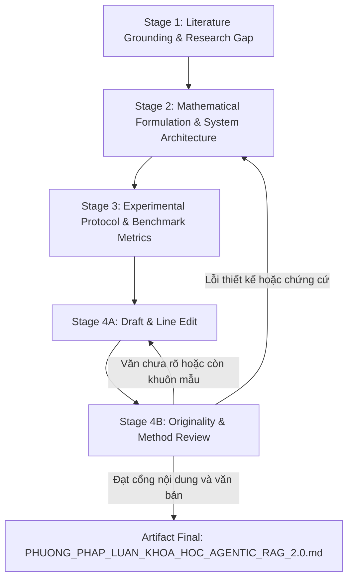

# 🏛️ AGENTIC RAG 2.0 — MASTER ORCHESTRATION HUB (KHUNG ĐIỀU PHỐI KHOA HỌC)

**Dự án:** Agentic RAG 2.0 (PGVector + Neo4j Graphiti + Multi-Agent Reasoning Loop)  
**Mục tiêu:** Viết và rà soát chương **Phương pháp luận Khoa học** cho bài môn học về Agentic RAG 2.0: rõ cách làm, đúng nguồn, khớp mã và đáp ứng yêu cầu giảng viên. Chỉ áp chuẩn công bố khi có yêu cầu riêng.  
**Phiên bản:** 2.1 — Khung viết phương pháp luận có kiểm chứng  

---

## 1. NGUYÊN TẮC CỐT LÕI (CORE PRINCIPLES)

1. **Evidence-First:** Mỗi tuyên bố phải có nguồn tài liệu, vị trí mã nguồn, kết quả đo, hoặc được ghi rõ là giả thuyết/thiết kế đề xuất. Chỉ dùng công thức khi nó mô tả thuật toán thực tế hoặc một giả thuyết sẽ được kiểm định.
2. **Falsifiability & Baselines:** Nêu câu hỏi nghiên cứu, giả thuyết có thể bác bỏ, biến đo, điều kiện đối chứng và tiêu chí đánh giá trước khi xem kết quả. Chọn baseline theo khả năng tái lập và mức công bằng; không mặc định mọi baseline đều phù hợp.
3. **Control Plane ≠ Execution Plane:** Antigravity điều phối tổng thể, phân rã công việc thành DAG rõ ràng; mỗi tác nhân chuyên biệt (Specialized Agent) chịu trách nhiệm một giai đoạn và bàn giao qua Artifact Contract.
4. **Phản biện có truy vết:** Bản thảo đi qua `scientific-thinking-scholar-evaluation` và `academic-paper-reviewer`; ghi nhận lỗi, bằng chứng, mức ảnh hưởng và cách xử lý. Chỉ gọi là phản biện mù khi danh tính tác giả thực sự được che.
5. **Tách trạng thái chứng cứ:** Mỗi thành phần được gắn nhãn `đã triển khai`, `đã đo`, `đề xuất`, hoặc `chưa xác minh`. Không trình bày kết quả dự kiến như kết quả thực nghiệm.
6. **Viết để người đọc hiểu:** Bản thảo phải giải thích quyết định, thao tác, đánh đổi và giới hạn cụ thể của nghiên cứu. Dàn ý, danh sách ý hoặc văn mẫu trơn tru chưa phải là chương phương pháp hoàn chỉnh.

---

## 2. BẢN ĐỒ VAI TRÒ & SKILLS (AGENT ROLES & CAPABILITIES)

```
[Control Plane: Antigravity Lead Orchestrator]
       │
       ├── 1. Khảo sát & Nền tảng: browser-use, literature-review, deep-research
       ├── 2. Mô hình hóa Hệ thống & Toán học: academic-paper, mle-workflow
       ├── 3. Thiết kế Thử nghiệm & Benchmark: mle-workflow, eval-harness
       └── 4. Viết bản thảo, kiểm tra tính nguyên gốc & Phản biện: academic-paper, scholar-evaluation, academic-paper-reviewer
```

| Tác nhân / Vai trò | Skills Tích hợp | Trách nhiệm chính |
| :--- | :--- | :--- |
| **Stage 1: Research & Gap Analyst** | `browser-use`<br>`scientific-thinking-literature-review`<br>`deep-research` | Tự động hóa duyệt web trên Chrome 9222 tra cứu SOTA (ArXiv, Google Scholar, Semantic Scholar, GitHub), phân tích giới hạn của Vector DB đơn thuần và Static GraphRAG, chỉ ra **Research Gap** cho đồ án. |
| **Stage 2: Method & System Architect** | `academic-paper`<br>`mle-workflow` | Đọc mã và mô tả nạp dữ liệu tuần tự, định tuyến `vector/graph/hybrid`, ghép ngữ cảnh và vòng lặp Critic. Công thức toán hoặc thuật toán mới phải được gắn nhãn đề xuất nếu chưa hiện thực. |
| **Stage 3: Benchmark & Eval Designer** | `mle-workflow`<br>`eval-harness` | Thiết kế tập đánh giá, nhãn chuẩn, baseline, thước đo, phân tích bóc tách, kiểm soát rò rỉ dữ liệu và kế hoạch tái lập. Chỉ dùng `benchmark-optimization-loop` khi thực sự tối ưu hiệu năng bằng các lần chạy đo được. |
| **Stage 4A: Methodology Writer & Line Editor** | `academic-paper` (`draft_writer_agent`, `writing_quality_check`) | Biến dàn ý thành đoạn văn hoàn chỉnh; làm rõ vì sao chọn phương pháp, cách thực hiện, đánh đổi và giới hạn. Biên tập từng câu theo chức năng của đoạn, tránh áp khuôn TEEL hoặc số chữ cố định. |
| **Stage 4B: Integrity & Method Reviewer** | `scientific-thinking-scholar-evaluation`<br>`academic-paper-reviewer` | Đối chiếu diễn đạt, trích dẫn và mã nguồn; phản biện lập luận, tính tái lập và tính nguyên gốc; yêu cầu sửa có vị trí và bằng chứng. |


---

## 3. DAG WORKFLOW VIẾT PHƯƠNG PHÁP LUẬN (4 GIAI ĐOẠN)



### Stage 1: Xác lập Cơ sở Lý thuyết & Khoảng trống Nghiên cứu
- **Đầu vào:** `agentic_rag_2.0_blueprint.md`, `BAO_CAO_NGHIEN_CUU_AGENTIC_RAG_2.0.md`.
- **Nhiệm vụ:**
  - Xác định câu hỏi nghiên cứu, phạm vi, đối tượng, biến đo và loại nghiên cứu (thiết kế hệ thống, đánh giá thực nghiệm hoặc cả hai).
  - Lập ma trận tài liệu liên quan, chỉ ra khoảng trống dựa trên nguồn đã kiểm tra; tránh xem mọi hệ thống RAG là một chuỗi thế hệ tuyến tính.
  - Xác định giới hạn của Dense Retrieval và Graph Retrieval theo điều kiện cụ thể, không coi đó là kết luận phổ quát.
- **Artifact đầu ra:** `artifacts/01_literature_and_gap_analysis.md`.

### Stage 2: Mô hình hóa Toán học & Thiết kế Kiến trúc Phương pháp
- **Đầu vào:** `artifacts/01_literature_and_gap_analysis.md`.
- **Nhiệm vụ:**
  - **Mô hình hóa bài toán (Problem Formulation):** Định nghĩa không gian truy vấn $\mathcal{Q}$, không gian văn bản $\mathcal{D}$, và Đồ thị tri thức động $\mathcal{G} = (\mathcal{V}, \mathcal{E}, \mathcal{T})$ với nhãn thời gian $t$.
  - **Mô tả đúng mã nguồn:** `backend/app/ingestion/database_sync.py` lưu PostgreSQL/PGVector trước, sau đó mới thêm episode vào Graphiti; có nhánh chấp nhận lỗi ở bước Graphiti. `backend/app/agents/router.py` định tuyến `vector`, `graph`, `hybrid`, ghép ngữ cảnh từ hai nguồn và lặp tối đa ba lượt với Critic.
  - **Công thức và giả mã:** Chỉ viết hàm chấm điểm lai hoặc MDP nếu có hiện thực tương ứng; nếu là cải tiến đề xuất, đặt trong tiểu mục riêng với giả định, tham số và phép thử. Không gọi quy trình nạp hiện tại là song song.
  - **Ma trận truy vết:** Mỗi bước thuật toán chỉ rõ đầu vào, đầu ra, điều kiện dừng, xử lý lỗi và đường dẫn mã nguồn hoặc nhãn `đề xuất`.
- **Artifact đầu ra:** `artifacts/02_mathematical_formulation_and_architecture.md`.

### Stage 3: Thiết kế Khung Thử nghiệm & Thang đo (Benchmark Protocol)
- **Đầu vào:** `artifacts/02_mathematical_formulation_and_architecture.md`.
- **Nhiệm vụ:**
  - **Bộ dữ liệu thử nghiệm:** Nêu nguồn, giấy phép, phiên bản/snapshot, tiêu chí chọn mẫu, quy trình gán nhãn và chia tập; tách câu hỏi single-hop, multi-hop, thời gian và trường hợp thiếu bằng chứng.
  - **Hệ thống chỉ số (Evaluation Matrix):**
    - Nhóm Chất lượng Truy xuất: Context Precision, Context Recall, Hit@K, MRR@K.
    - Nhóm Độ trung thực & Lập luận: Faithfulness/Groundedness, độ đúng câu trả lời và độ đủ bằng chứng; mô tả cách chấm, người chấm hoặc mô hình chấm và kiểm tra độ nhất quán.
    - Nhóm Hiệu năng Kỹ thuật: P50/P95 Latency, Token Cost / Query, CPU/RAM; chỉ đo Neo4j Hop Depth khi luồng truy vấn thực sự cung cấp thông tin này.
  - **Kế hoạch Ablation Study:** So sánh Vector-only, Graph-only, Hybrid không Critic và Hybrid hoàn chỉnh trên cùng tập truy vấn, cùng mô hình sinh, ngân sách và cấu hình; ghi số lần lặp và độ bất định.
- **Artifact đầu ra:** `artifacts/03_benchmark_and_eval_protocol.md`.

### Stage 4: Viết bản thảo, kiểm tra tính nguyên gốc & phản biện khoa học
- **Đầu vào:** Hợp nhất từ Stage 1, 2, 3.
- **Nhiệm vụ:**
  - Giao vai trò viết văn cho `academic-paper/draft_writer_agent`: viết `artifacts/methodology_draft.md` từ khung, ma trận chứng cứ và dấu vết dự án theo [quy trình viết và liêm chính bản thảo](workflows/academic-writing-integrity.md). Mỗi tiểu mục phải có đoạn văn hoàn chỉnh giải thích lựa chọn phương pháp và đánh đổi cụ thể; tách ý của nguồn, mô tả hệ thống hiện tại và đề xuất chưa triển khai.
  - Biên tập hai lượt: trước hết kiểm tra mạch lập luận và chức năng từng đoạn; sau đó sửa câu sáo rỗng, lặp nhịp, chuyển ý máy móc và tính từ không có căn cứ. Không áp độ dài đoạn hoặc mẫu TEEL như chỉ tiêu cứng.
  - Rà soát từng đoạn về ý chính, căn cứ, diễn đạt lại, trích dẫn sát mệnh đề và nguy cơ trùng lặp; ghi vấn đề đã sửa và điểm còn cần tác giả quyết định.
  - Kích hoạt `scientific-thinking-scholar-evaluation` để rà soát theo thang điểm 5 chiều (Rubric 1–5).
  - Tìm kiếm các điểm thiếu nhất quán giữa lý thuyết và mã nguồn hiện thực (`backend/` và `cli.py`).
  - Kiểm tra khả năng tái lập: phiên bản mã/phụ thuộc, cấu hình, dữ liệu, seed khi áp dụng, phần cứng, lệnh chạy và giới hạn truy cập. Báo cáo các đe dọa đến giá trị kết luận.
- **Artifact đầu ra:** `artifacts/04_adversarial_review_report.md` và ấn bản chính thức `PHUONG_PHAP_LUAN_KHOA_HOC_AGENTIC_RAG_2.0.md`.

---

## 4. CHUẨN MỰC CHẤT LƯỢNG (QUALITY GATES)

- **Chuẩn công thức toán:** Dùng định dạng LaTeX chuẩn `$$ ... $$` cho block và `$ ... $` cho inline. Ký hiệu nhất quán toàn tài liệu.
- **Chuẩn sơ đồ kiến trúc:** Mermaid diagram có đầy đủ data flow, protocol kết nối (Port 5432, 7687, REST API), và tên các Agent rõ ràng.
- **Chuẩn trích dẫn:** Chỉ đưa tài liệu đã xác minh metadata và nội dung liên quan trực tiếp đến tuyên bố; không ép trích dẫn một danh sách tên cố định.
- **Ngôn ngữ:** Tiếng Việt học thuật chuẩn mực (Academic Vietnamese), thuật ngữ khoa học máy tính giữ nguyên gốc tiếng Anh hoặc dịch kèm chú giải chuẩn.
- **Cổng văn bản:** Mỗi tiểu mục trả lời rõ “vì sao chọn”, “làm thế nào”, “đánh đổi gì”, “giới hạn ở đâu”; đoạn văn có chức năng, câu có chủ thể và thuật ngữ nhất quán. Nếu chỉ còn lời dẫn chung hoặc câu bóng bẩy thiếu thông tin, trả về Stage 4A để viết lại.
- **Liêm chính văn bản cho bài môn học:** Mọi ý vay mượn phải có nguồn; câu nguyên văn phải được đánh dấu; diễn đạt lại phải thể hiện sự hiểu đúng chứ không chỉ thay từ. Kiểm tra thủ công các đoạn nghi ngờ và xem báo cáo Turnitin nếu môn học cung cấp; không bắt buộc mua công cụ hoặc lập báo cáo kiểm toán. Báo cáo tương đồng là tín hiệu rà soát, không tự kết luận đạo văn. Xem [quy trình viết và kiểm tra bản thảo](workflows/academic-writing-integrity.md).
- **Điều kiện hoàn thành:** Không còn lỗi nghiêm trọng về sai lệch mã nguồn, nguồn trích dẫn hoặc thiết kế thực nghiệm; điểm rubric chỉ là tín hiệu hỗ trợ, không thay thế các điều kiện này. Người hướng dẫn/tác giả duyệt lựa chọn học thuật cuối cùng.
- **Đường dẫn điều phối:** Xem [workflow chi tiết](workflows/scientific-methodology-pipeline.md). `artifacts/` là nơi ghi kết quả khi thực sự chạy pipeline; tài liệu điều phối không tự tạo kết quả nghiên cứu.

---

## 5. QUY CHUẨN TÌM KIẾM TÀI LIỆU KHOA HỌC BẰNG BROWSER-USE (PORT 9222)

Theo quy định an toàn và kiểm chứng của hệ thống (Master Rule §16), **độc quyền sử dụng MCP `browser-use` (`browser_exec`, `browser_screenshot`)** cho mọi hoạt động tra cứu tài liệu học thuật trực tuyến (ArXiv, Google Scholar, Semantic Scholar, Papers with Code, GitHub).

### 5.1. Giao thức Pre-warmed Chrome & Health Guard (Bắt buộc)
Người dùng duy trì Chrome gỡ lỗi tại cổng 9222:
```powershell
chrome.exe --remote-debugging-port=9222 --user-data-dir="C:\ChromeDebugProfile"
```
- **BƯỚC 1 (Tiên quyết):** LUÔN LUÔN chạy script làm sạch môi trường trước khi gọi bất kỳ browser tool nào:
  ```powershell
  python C:\Users\vodan\.gemini\config\scripts\browser_health_guard.py
  ```
- **BƯỚC 2:** Sau khi script xác nhận sẵn sàng, gọi MCP tool `browser-use` (`browser_exec`).

### 5.2. Chuẩn viết mã Browser-Exec (Zero-Syntax Error)
1. **Điều hướng tab an toàn:** Dùng `new_tab(url)` cho truy cập ban đầu, theo sau là `wait_for_load()` và `import time; time.sleep(1)` để đảm bảo DOM render đầy đủ.
2. **Không viết chuỗi JavaScript đa dòng:** Tránh lỗi cú pháp `SyntaxError: Invalid or unexpected token`. Tuyệt đối không viết hàm JS nhiều dòng trong `js("""...""")`.
3. **Lấy thô (Raw) 1 dòng JS + Xử lý bóc tách bằng Python cục bộ:**
   ```python
   # Lấy thô toàn bộ nội dung trang hoặc HTML
   text = js("document.body.innerText")
   html = js("document.body.innerHTML")

   # Xử lý trích xuất tiêu đề, tác giả, DOI, abstract, baseline metrics 100% bằng Python
   import re
   papers = re.findall(r'<h3 class="gs_rt">.*?<a[^>]*>(.*?)</a>', html)
   ```
4. **Lưu vết ảnh chụp (Evidence Screenshot):** Khi trích xuất các bảng so sánh SOTA hoặc số liệu đối chuẩn từ bài báo gốc, gọi `browser_screenshot(full=True)` để lưu vào artifacts làm bằng chứng thực chứng.
