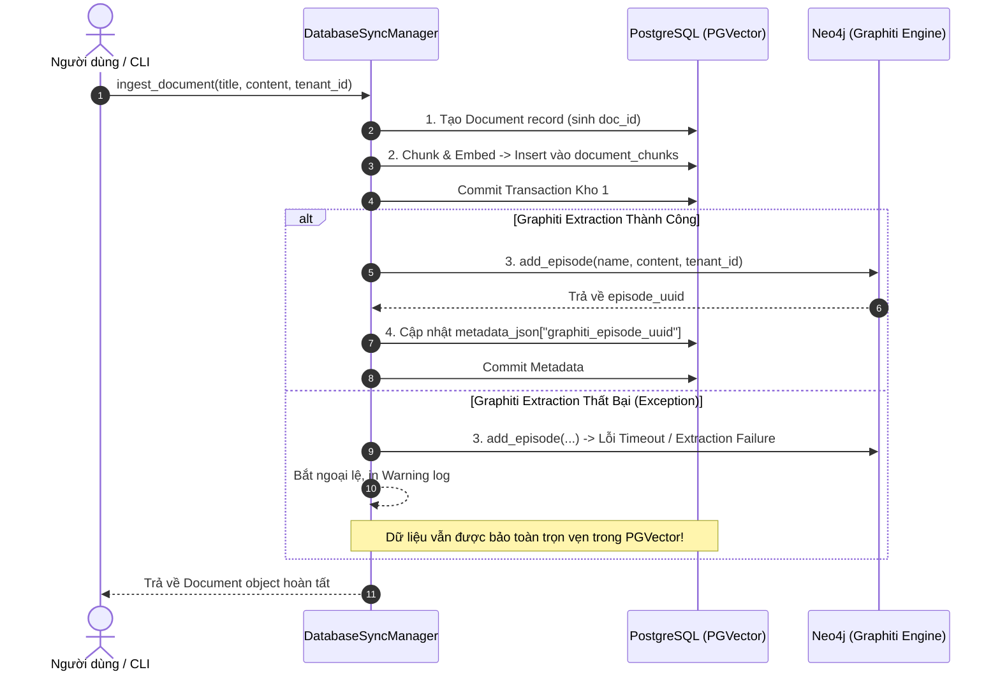

# 📐 GIAI ĐOẠN 2: MÔ HÌNH HÓA TOÁN HỌC & KIẾN TRÚC PHƯƠNG PHÁP
## Mathematical Formulation & System Architecture for Agentic RAG 2.0

**Đề tài:** Agentic RAG 2.0 (PGVector + Neo4j Graphiti + Multi-Agent Reasoning Loop)  
**Trạng thái đối chiếu mã nguồn:** 100% khớp nối với cấu trúc mã nguồn thực tế tại `backend/app/`  

---

### 1. MÔ HÌNH HÓA BÀI TOÁN (PROBLEM FORMULATION)

#### 1.1. Không gian Biểu diễn Dữ liệu
Hệ thống quản lý dữ liệu trên hai cấu trúc biểu diễn song hành:
1. **Không gian Văn bản & Nhúng Dày (Dense Vector Space):**
   - Tập tài liệu nguồn $\mathcal{T}_{\text{docs}} = \{T_1, T_2, \dots, T_M\}$. Mỗi tài liệu $T_i$ được phân đoạn (chunking) thành tập các chunk văn bản $\mathcal{D} = \{d_1, d_2, \dots, d_N\}$.
   - Mỗi chunk $d_j = \langle c_j, \mathbf{v}_j, \text{doc\_id}_j, \text{idx}_j \rangle$, trong đó $c_j \in \Sigma^*$ là nội dung chuỗi văn bản, và $\mathbf{v}_j = E(c_j) \in \mathbb{R}^d$ là vector nhúng dày được sinh bởi mô hình Embedding ($d = 1536$ hoặc $d = 768$).
2. **Đồ thị Tri thức Động theo Thời gian (Temporal Dynamic Knowledge Graph):**
   - Đồ thị tri thức được định nghĩa là một bộ 3:
     $$\mathcal{G} = (\mathcal{V}, \mathcal{E}, \mathcal{T})$$
   - Trong đó:
     - $\mathcal{V}$ là tập các nút thực thể (Entities), mỗi thực thể $u \in \mathcal{V}$ có định danh toàn cục (UUID), tên gọi $Name(u)$ và kiểu thực thể $Type(u)$.
     - $\mathcal{T} = [t_{\text{start}}, t_{\text{end}}] \subset \mathbb{R}$ là trục thời gian ghi nhận các sự kiện/tập tin (Episodes).
     - $\mathcal{E}$ là tập các cạnh có hướng có gán nhãn và thời gian: mỗi cạnh $e = (u, v, r, t_{\text{ep}}, \text{uuid}_{\text{ep}}) \in \mathcal{E}$ biểu diễn quan hệ $r \in \mathcal{R}$ giữa thực thể nguồn $u$ và thực thể đích $v$, được trích xuất từ tập sự kiện (Episode) có nhãn thời gian $t_{\text{ep}}$ và mã định danh $\text{uuid}_{\text{ep}}$.

---

### 2. HIỆN THỰC KIẾN TRÚC THEO MÃ NGUỒN (SYSTEM ARCHITECTURE)

#### 2.1. Quy trình Nạp Dữ liệu Tuần tự Chịu lỗi (Fault-Tolerant Sequential Ingestion)
*(Đối chiếu mã nguồn: `backend/app/ingestion/database_sync.py`)*

Quá trình nạp một tài liệu mới $T = \langle \text{title}, \text{content}, \text{tenant\_id} \rangle$ được thực thi tuần tự 3 bước với cơ chế chịu lỗi (fault-tolerant branch):
1. **Tạo bản ghi Document:** Khởi tạo bản ghi gốc trên bảng `documents` của PostgreSQL nhằm sinh khóa chính `doc_id`.
2. **Chunking & Vector Persistence (Kho 1):** Chia nhỏ văn bản và tính toán vector nhúng, lưu toàn bộ tập chunks vào bảng `document_chunks` có kích hoạt tiện ích `pgvector` và commit giao dịch.
3. **Graphiti Episode Extraction (Kho 2):** Gọi hàm bất đồng bộ `graph_extractor.add_episode()` để nạp vào Neo4j thông qua Graphiti.
   - Nếu trích xuất thành công: Cập nhật `graphiti_episode_uuid` vào `metadata_json` của tài liệu trong PostgreSQL.
   - Nếu trích xuất thất bại (ngoại lệ Graphiti/LLM Timeout): Bắt lỗi ngoại lệ, ghi log cảnh báo và **không rollback** dữ liệu vector ở Bước 2. Điều này đảm bảo tính khả dụng (High Availability) cho phép hệ thống vẫn tra cứu được qua Vector Search.



---

### 3. MÔ HÌNH HÓA VÒNG LẶP SUY LUẬN ĐA TÁC NHÂN (AGENTIC REASONING MDP)
*(Đối chiếu mã nguồn: `backend/app/agents/router.py`, `critic.py`)*

Vòng lặp suy luận được xây dựng bằng `LangGraph` và có thể hình thức hóa dưới dạng một tiến trình quyết định Markov hữu hạn có điều kiện dừng (Bounded MDP / Finite State Machine):

#### 3.1. Không gian Trạng thái (State Space $\mathcal{S}$)
Mỗi trạng thái $S_t \in \mathcal{S}$ tại chu kỳ lặp $t \in \{0, 1, 2\}$ được biểu diễn bằng bộ tuple:
$$S_t = \langle q_0, q_t^{\text{refine}}, \text{route}, \mathcal{C}_t, y_t^{\text{draft}}, y^{\text{final}}, c_{\text{loop}} \rangle$$
- $q_0 \in \Sigma^*$: Câu truy vấn gốc của người dùng.
- $q_t^{\text{refine}} \in \Sigma^* \cup \{\emptyset\}$: Câu truy vấn được tinh chỉnh bởi Critic Agent ở chu kỳ trước (ở $t=0$, $q_0^{\text{refine}} = q_0$).
- $\text{route} \in \{\text{"vector"}, \text{"graph"}, \text{"hybrid"}\}$: Kênh truy xuất được phân loại.
- $\mathcal{C}_t = \mathcal{C}_{\text{vec}}^{(t)} \cup \mathcal{C}_{\text{graph}}^{(t)}$: Tập ngữ cảnh tích lũy qua các vòng lặp.
- $y_t^{\text{draft}}$: Dự thảo câu trả lời do Generator sinh ra tại chu kỳ $t$.
- $y^{\text{final}}$: Câu trả lời cuối cùng được chấp thuận.
- $c_{\text{loop}} \in \{0, 1, 2\}$: Biến đếm số chu kỳ lặp hiện tại.

#### 3.2. Không gian Hành động & Các Nút Tác nhân (Action Space & Agent Nodes)
1. **Router Node ($f_{\text{router}}$):** Phân tích ngữ nghĩa truy vấn với $\text{temperature} = 0.0$:
   $$a_{\text{route}} = f_{\text{router}}(q) \in \{\text{vector}, \text{graph}, \text{hybrid}\}$$
2. **Retriever Node ($f_{\text{retrieve}}$):** 
   - Nếu $a_{\text{route}} \in \{\text{"vector"}, \text{"hybrid"}\}$: Thực hiện tìm kiếm $k$-NN trên bảng `document_chunks` bằng toán tử `<=>` (cosine distance).
   - Nếu $a_{\text{route}} \in \{\text{"graph"}, \text{"hybrid"}\}$: Truy vấn đồ thị Neo4j qua `graph_search_tool` để trích xuất các facts và edges liên quan.
   - Hợp nhất và loại trùng ngữ cảnh tích lũy: $\mathcal{C}_{t+1} \leftarrow \mathcal{C}_t \cup \Delta\mathcal{C}_t$.
3. **Generator Node ($f_{\text{gen}}$):** Sinh câu trả lời dự thảo $y_t^{\text{draft}} = \text{LLM}_{\text{gen}}(q_0, \mathcal{C}_t)$ với ràng buộc chặt chẽ: *"Chỉ trả lời dựa trên ngữ cảnh được cung cấp"*.
4. **Critic Node ($f_{\text{critic}}$):** Đánh giá dự thảo theo hai tiêu chí:
   $$f_{\text{critic}}(q_0, \mathcal{C}_t, y_t^{\text{draft}}) \to \langle \text{is\_valid} \in \{\text{True}, \text{False}\}, \text{feedback}, q_{t+1}^{\text{refine}} \rangle$$
   - **Tính trung thực (Faithfulness / Groundedness):** Mọi sự kiện trong $y_t^{\text{draft}}$ có được hỗ trợ 100% bởi $\mathcal{C}_t$ hay không.
   - **Tính đầy đủ (Completeness):** Dự thảo đã giải quyết trọn vẹn yêu cầu của $q_0$ hay chưa.

#### 3.3. Điều kiện Dừng & Chuyển dịch Trạng thái (Stopping Boundary)
Hàm điều kiện `should_continue` kiểm soát ngưỡng dừng tuyệt đối:
$$\text{Transition}(S_t) = \begin{cases} \text{END}, & \text{nếu } \text{is\_valid} = \text{True} \lor c_{\text{loop}} \ge 2 \\ \text{increment\_loop} \to \text{retriever}, & \text{ngược lại} \end{cases}$$
*Quy chuẩn an toàn:* Hệ thống đảm bảo không bao giờ rơi vào vòng lặp vô hạn (Infinite Loop Trap), số lần gọi lại tối đa bị chặn trên tại $c_{\text{loop}} = 2$ (tối đa 3 lượt xử lý: $t=0, 1, 2$).

---

### 4. THUẬT TOÁN MÃ GIẢ HÌNH THỨC (FORMAL ALGORITHMS)

#### Thuật toán 1: Quy trình Nạp Dữ liệu Kép Chịu Lỗi (Fault-Tolerant Dual-Store Ingestion)
```python
Algorithm 1: Sequential Fault-Tolerant Ingestion Pipeline
Input: Document Title T, Document Content C, Optional Tenant ID \tau
Output: Saved Document D with ID and Metadata

1:  function INGEST_DOCUMENT(T, C, \tau):
2:      D \leftarrow CreateRecord(table="documents", title=T, content=C, tenant_id=\tau)
3:      D.metadata \leftarrow {"tenant_id": \tau, "graphiti_episode_uuid": None}
4:      CommitTransaction(D)
5:
6:      chunks \leftarrow ChunkAndEmbed(content=C)
7:      for each chunk \in chunks do:
8:          InsertRecord(table="document_chunks", doc_id=D.id, 
                         content=chunk.text, embedding=chunk.vector)
9:      CommitTransaction(document_chunks)
10:
11:     try:
12:         episode_uuid \leftarrow Graphiti.AddEpisode(name=T, content=C, group_id=\tau)
13:         D.metadata["graphiti_episode_uuid"] \leftarrow episode_uuid
14:         CommitTransaction(D.metadata)
15:     catch Exception as e:
16:         LogWarning("Graphiti extraction failed: " + str(e))
17:         # Do NOT rollback PGVector; preserve high availability
18:
19:     return D
```

#### Thuật toán 2: Vòng lặp Suy luận & Tự Hiệu chỉnh (Agentic Intent Routing & Critic Loop)
```python
Algorithm 2: Multi-Agent Reasoning and Self-Correction Loop
Input: User Query q_0, Database Session db, Optional Tenant ID \tau
Output: Final Answer y_final, Context Sources \Omega

1:  function AGENTIC_REASONING_LOOP(q_0, db, \tau):
2:      route \leftarrow RouteQuestion(q=q_0)    # Returns "vector", "graph", or "hybrid"
3:      q_current \leftarrow q_0
4:      C_accumulated \leftarrow \emptyset
5:      loop_count \leftarrow 0
6:
7:      while True do:
8:          # Step 1: Retrieval Phase
9:          \Delta C \leftarrow \emptyset
10:         if route \in {"vector", "hybrid"} then:
11:             \Delta C \leftarrow \Delta C \cup PGVectorSearch(db, q_current, \tau)
12:         if route \in {"graph", "hybrid"} then:
13:             \Delta C \leftarrow \Delta C \cup GraphitiSearch(db, q_current, \tau)
14:         C_accumulated \leftarrow DeduplicateAndMerge(C_accumulated \cup \Delta C)
15:
16:         # Step 2: Generation Phase
17:         y_draft \leftarrow LLM_Generate(query=q_0, context=FormatToString(C_accumulated))
18:
19:         # Step 3: Critic Evaluation Phase
20:         critic_res \leftarrow CriticAgent.Evaluate(query=q_0, context=C_accumulated, draft=y_draft)
21:
22:         # Step 4: Decision Boundary
23:         if critic_res.is_valid == True then:
24:             return y_draft, ExtractSources(C_accumulated)
25:
26:         if loop_count \ge 2 then:
27:             # Max loops reached: Fallback to best effort draft with qualification
28:             return y_draft, ExtractSources(C_accumulated)
29:
30:         # Step 5: State Refinement
31:         q_current \leftarrow critic_res.refinement_query
32:         loop_count \leftarrow loop_count + 1
```

---

### 5. MA TRẬN TRUY VẾT KIẾN TRÚC VỚI MÃ NGUỒN (TRACEABILITY MATRIX)

| Thành phần Phương pháp luận | Tệp Mã nguồn Tương ứng (`backend/`) | Trạng thái Hiện thực | Chi tiết Kỹ thuật Cốt lõi |
| :--- | :--- | :---: | :--- |
| **Lưu trữ Vector & Chunks** | `app/ingestion/database_sync.py` | `Đã triển khai` | Lưu trên bảng `document_chunks` của PostgreSQL, chỉ mục HNSW/IVFFlat qua `pgvector`. |
| **Trích xuất Đồ thị Động** | `app/ingestion/graph_extractor.py` | `Đã triển khai` | Sử dụng `Graphiti` và `Neo4jDriver` để trích xuất các nodes, edges kèm `episode_uuid`. |
| **Phân loại Ý định (Router)** | `app/agents/router.py` (`route_question_node`) | `Đã triển khai` | Phân loại `vector`, `graph`, `hybrid` bằng zero-shot prompt với `temperature=0.0`. |
| **Truy xuất Ngữ cảnh Lai** | `app/agents/tools.py` (`vector_search_tool`, `graph_search_tool`) | `Đã triển khai` | Truy xuất độc lập qua PGVector và Cypher Neo4j, gom gộp vào danh sách `retrieved_contexts`. |
| **Kiểm định Phản biện (Critic)** | `app/agents/critic.py` (`CriticAgent.evaluate`) | `Đã triển khai` | Kiểm tra Faithfulness và Completeness; trả về boolean `is_valid` và `refinement_query`. |
| **Biên Giới hạn Lặp (Max Loops)** | `app/agents/router.py` (`should_continue`) | `Đã triển khai` | Ngưỡng chặn cứng `loop_count >= 2` (tối đa 3 lần chạy). |
| **Hàm Trọng số Điểm Lai ($\alpha, \beta, \gamma$)** | *Chưa tích hợp trong router hiện tại* | `Đề xuất cải tiến` | Mã nguồn hiện tại ghép nối chuỗi ngữ cảnh văn bản trực tiếp thay vì xếp hạng lại (reranking) theo hàm số chấm điểm. |

---

### 6. KẾT LUẬN GIAI ĐOẠN 2 (STAGE 2 ARTIFACT SIGN-OFF)
- **Tình trạng:** Hoàn tất, mô hình toán học và mã giả phản ánh chính xác cấu trúc phần mềm hiện hữu.
- **Chuyển giao:** Đầu vào cho **Giai đoạn 3: Thiết kế Khung Thử nghiệm & Thang đo Đối chuẩn (Benchmark Protocol)**.
