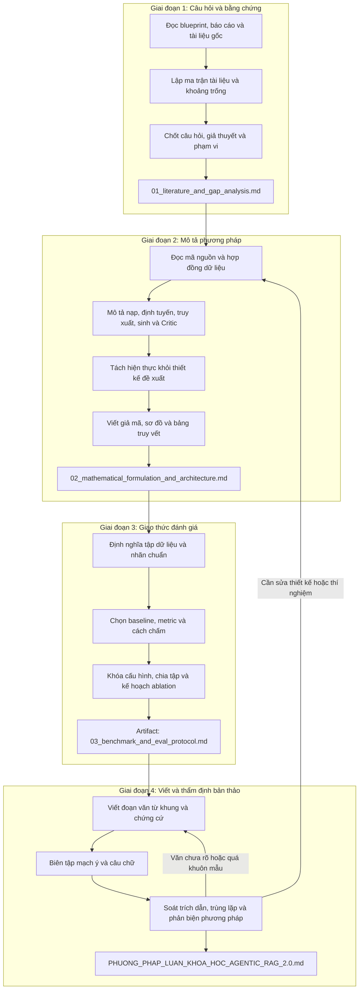

# 🚀 WORKFLOW: QUY TRÌNH THỰC HIỆN VIẾT PHƯƠNG PHÁP LUẬN KHOA HỌC (AGENTIC RAG 2.0)

**Mục tiêu:** Hướng dẫn 4 giai đoạn để viết chương Phương pháp luận rõ nghĩa, có thể kiểm tra và tái lập. Giai đoạn cuối gồm viết văn, rà soát tính nguyên gốc rồi phản biện. Mỗi tuyên bố phải truy về tài liệu, mã nguồn, kết quả đo hoặc được đánh dấu là đề xuất.

**Mức áp dụng:** Mặc định cho bài môn học. Ở bước liêm chính, kiểm tra nguồn và các đoạn nghi ngờ, dùng báo cáo tương đồng của môn học nếu được cấp. Báo cáo phản biện có thể là danh sách sửa ngắn; không bắt buộc phần mềm trả phí, tỷ lệ tương đồng mục tiêu hay quy trình kiểm toán của bài báo.

**Nguồn skill:** Đã đối chiếu `C:/Users/vodan/.gemini/config/skills/` với bản dùng trong `.agents/skills/`. Dùng `deep-research` và `scientific-thinking-literature-review` cho nền tảng; `academic-paper` cho cấu trúc và văn phong; `mle-workflow` và `eval-harness` cho thiết kế đánh giá; `scientific-thinking-scholar-evaluation` và `academic-paper-reviewer` cho phản biện. `benchmark-methodology` trong bộ skill hiện có đánh giá đối thủ thương hiệu, không áp dụng cho benchmark RAG. `benchmark-optimization-loop` chỉ dùng khi chạy tối ưu lặp có baseline và ngân sách đo.

---

## 📋 TỔNG QUAN CÁC GIAI ĐOẠN (EXECUTION DAG)



---

## 🛠️ CHI TIẾT TỪNG BƯỚC THỰC THI (STEP-BY-STEP RUNBOOK)

### 📌 Giai đoạn 1: Nền tảng Lý thuyết & Khoảng trống Nghiên cứu (Literature Grounding)
- **Kỹ năng sử dụng:** 
  - `skills/browser-use` (Tra cứu học thuật trực tuyến có kiểm chứng trên Chrome 9222)
  - `skills/scientific-thinking-literature-review`
  - `skills/deep-research`
- **Quy trình tra cứu tài liệu trực tuyến (Browser-Use Runbook):**
  1. **Bước kích hoạt môi trường:** Bắt buộc chạy health guard trước khi duyệt web:
     ```powershell
     python C:\Users\vodan\.gemini\config\scripts\browser_health_guard.py
     ```
  2. **Truy vấn tài liệu gốc trên ArXiv / Google Scholar:** Sử dụng `browser_exec` điều hướng đến Google Scholar / ArXiv / Semantic Scholar:
     - Tập từ khóa mục tiêu: `"Agentic RAG"`, `"Graphiti temporal knowledge graph"`, `"Hybrid dense graph retrieval"`, `"Self-RAG"`, `"Microsoft GraphRAG"`.
     - Lấy thô DOM bằng 1 dòng JS: `text = js("document.body.innerText")` hoặc `html = js("document.body.innerHTML")`.
     - Phân tích bóc tách (Parsing) tiêu đề, tác giả, năm, DOI, tóm tắt (Abstract) hoàn toàn bằng Python.
     - Chụp ảnh màn hình `browser_screenshot(full=True)` làm bằng chứng đối chiếu khi cần kiểm chứng bảng kết quả SOTA.
- **Mục tiêu thực hiện:**
  1. Viết câu hỏi nghiên cứu và giả thuyết có thể bác bỏ cho chất lượng trả lời, truy xuất đa chặng và dữ liệu thay đổi theo thời gian nếu dữ liệu hỗ trợ.
  2. Lập bảng nguồn gồm DOI/URL, phiên bản, đóng góp, giới hạn và tuyên bố được hỗ trợ; phân biệt tài liệu gốc với nhận định của tác giả.
  3. Xác định khoảng trống trong đúng phạm vi tập dữ liệu và tác vụ; ghi cả công trình phản chứng hoặc kết quả không thuận lợi.
- **Tiêu chuẩn nghiệm thu:** Có câu hỏi, phạm vi, giả thuyết, bảng nguồn đã kiểm tra và khoảng trống có căn cứ. Không dùng phân loại “5 thế hệ” như một thực tế đã được chứng minh.


---

### 📌 Giai đoạn 2: Mô hình hóa Toán học & Kiến trúc Đề xuất (Method Modeling)
- **Kỹ năng sử dụng:**
  - `skills/academic-paper`
  - `skills/mle-workflow`
- **Mục tiêu thực hiện:**
  1. **Định nghĩa hệ thống:** Đơn vị phân tích là truy vấn, tài liệu/chunk, fact đồ thị và câu trả lời. Định nghĩa rõ đầu vào, đầu ra, tập ký hiệu và giới hạn thời gian nếu đo truy vấn thời gian.
  2. **Nạp dữ liệu:** Đối chiếu `backend/app/ingestion/database_sync.py`. PostgreSQL/PGVector được ghi trước; Graphiti được gọi sau và có đường lỗi riêng. Mô tả nhất quán dữ liệu và hậu quả khi chỉ một kho được cập nhật.
  3. **Truy vấn:** Đối chiếu `backend/app/agents/router.py` và `backend/app/agents/tools.py`. Router chọn `vector`, `graph` hoặc `hybrid`; nhánh `hybrid` gom ngữ cảnh, không có hàm trọng số $\alpha,\beta,\gamma$ trong mã hiện tại. Critic có thể yêu cầu truy xuất lại; ghi điều kiện dừng và xử lý khi không đủ bằng chứng.
  4. **Mô hình hình thức:** Chỉ đưa công thức, MDP hoặc giả mã tương ứng với mã hiện có. Nếu đề xuất thuật toán mới, tách tiểu mục “Đề xuất chưa triển khai” và gắn phép thử kiểm định.
- **Tiêu chuẩn nghiệm thu:** Có sơ đồ luồng, giả mã, bảng ký hiệu và bảng truy vết `tuyên bố → mã/nguồn → trạng thái → phép kiểm tra`. Không mô tả nạp dữ liệu là song song.

---

### 📌 Giai đoạn 3: Khung Thử nghiệm & Thang đo (Benchmark Protocol)
- **Kỹ năng sử dụng:**
  - `skills/mle-workflow`
  - `skills/eval-harness`
  - `skills/benchmark-optimization-loop` (chỉ khi tối ưu hiệu năng lặp)
- **Mục tiêu thực hiện:**
  1. **Tập dữ liệu:** Nêu nguồn, giấy phép, thời điểm chụp, tiêu chí chọn/loại, số mẫu theo nhóm single-hop/multi-hop/temporal/không đủ bằng chứng, nhãn chuẩn và cách xử lý bất đồng người gán nhãn.
  2. **Baseline công bằng:** Chọn tối thiểu đường truy xuất vector hiện có và các biến thể có thể chạy được; nếu dùng GraphRAG hoặc Self-RAG ngoài dự án, phải mô tả hiện thực, chi phí và giới hạn so sánh. Giữ cùng mô hình sinh, prompt, tập truy vấn, ngân sách và điều kiện chạy.
  3. **Chỉ số:** Định nghĩa đơn vị và cách tính Hit@K, MRR@K, độ đúng câu trả lời, độ bám nguồn, latency P50/P95, token và chi phí. Các metric kiểu Ragas chỉ dùng khi phiên bản, bộ chấm và khả năng tính đã xác minh; nêu sai số/độ tin cậy khi thích hợp.
  4. **Ablation:** Vector-only, Graph-only, Hybrid không Critic và Hybrid đầy đủ nếu từng cấu hình chạy được; khóa cấu hình, lặp phép đo, tách tập phát triển và tập đánh giá cuối, phân tích lỗi và rò rỉ dữ liệu.
- **Tiêu chuẩn nghiệm thu:** Có ma trận `biến thể × nhóm câu hỏi × metric`, phương pháp lấy mẫu, cấu hình, số lần chạy, cách tổng hợp và kế hoạch công bố cả kết quả âm.

---

### 📌 Giai đoạn 4: Viết bản thảo, kiểm tra tính nguyên gốc và phản biện
- **Kỹ năng sử dụng:**
  - `skills/academic-paper` (`draft_writer_agent` để viết đoạn hoàn chỉnh; `writing_quality_check` để chẩn đoán câu chữ)
  - `skills/scientific-thinking-scholar-evaluation`
  - `skills/academic-paper-reviewer`
- **Mục tiêu thực hiện:**
  1. **Viết (4A):** Từ artifact 1–3, lập bản đồ đoạn rồi viết `artifacts/methodology_draft.md` theo [quy trình viết và liêm chính bản thảo](academic-writing-integrity.md). Mỗi tiểu mục phải giải thích vì sao chọn cách làm, thao tác đã thực hiện, đánh đổi và giới hạn. Khi thiếu chứng cứ, ghi nhãn cần xác minh thay vì tự điền. Nếu có mẫu văn do tác giả tự viết, dùng để hiệu chỉnh giọng ở mức đặc điểm biên tập, không sao chép câu.
  2. **Biên tập (4A):** Kiểm tra chức năng từng đoạn, quan hệ giữa các đoạn, câu mở đầu có thông tin, thuật ngữ và nhịp câu phù hợp. Không áp TEEL, số câu dẫn chứng hoặc độ dài đoạn cố định; tránh mọi đoạn có cùng cấu trúc. Đọc thành tiếng các đoạn khó và yêu cầu tác giả giải thích những câu không rõ nguồn hoặc ý.
  3. **Liêm chính (4B):** So ý với nguồn gốc, kiểm tra trích dẫn sát mệnh đề, đánh dấu trích nguyên văn và sửa diễn đạt lại quá sát. Với bài môn học, chỉ ghi các đoạn nghi ngờ và cách sửa; dùng báo cáo Turnitin nếu giảng viên cung cấp. Không dùng điểm tương đồng hoặc bộ phát hiện AI để tự kết luận vi phạm.
  4. **Phản biện (4B):** Đánh giá độc lập theo rubric 1–5 khi có người/phiên đánh giá tách khỏi người viết; chỉ gọi là mù khi đã ẩn danh tác giả. Kiểm tra:
     - Tính mới & Đóng góp khoa học (Novelty & Contribution)
     - Tính chặt chẽ về mặt toán học (Mathematical Soundness)
     - Tính khả thi & Tái lập (Reproducibility & Code-Alignment với mã nguồn `backend/`)
     - Phân tích giới hạn (Limitations & Threats to Validity)
  5. Kiểm tra từng trích dẫn, thuật toán, số liệu và giả định; ghi lỗi theo mức nghiêm trọng, người xử lý và bằng chứng đóng lỗi.
  6. Chỉnh sửa và tổng hợp thành `PHUONG_PHAP_LUAN_KHOA_HOC_AGENTIC_RAG_2.0.md`.
- **Tiêu chuẩn nghiệm thu:** Mỗi tiểu mục có đoạn văn hoàn chỉnh và thông tin riêng của nghiên cứu, không chỉ là bullet list hoặc diễn đạt chung. Không còn lỗi nghiêm trọng về sai lệch mã, trích dẫn, trùng lặp chưa xử lý, rò rỉ dữ liệu hoặc baseline không công bằng. Điểm rubric được báo cáo theo từng chiều, không dùng trung bình 4.5 làm điều kiện duy nhất. Tác giả/người hướng dẫn duyệt quyết định học thuật cuối cùng.

---

## Hợp đồng bàn giao giữa các giai đoạn

Các đường dẫn `artifacts/...` được hiểu tương đối với `.agents/`. Chỉ tạo artifact khi chạy giai đoạn tương ứng; không tự điền kết quả chưa đo.

| Giai đoạn | Tệp bàn giao | Trường tối thiểu | Kiểm tra trước khi nhận |
| :--- | :--- | :--- | :--- |
| 1 | `artifacts/01_literature_and_gap_analysis.md` | Câu hỏi, phạm vi, giả thuyết, ma trận nguồn, khoảng trống, nguồn phản chứng | Mỗi nguồn có định danh kiểm tra được; khoảng trống gắn với câu hỏi nghiên cứu |
| 2 | `artifacts/02_mathematical_formulation_and_architecture.md` | Ký hiệu, luồng xử lý, giả mã, bảng truy vết mã, trạng thái triển khai | Từng công thức có ý nghĩa và khớp mã hoặc được gắn nhãn đề xuất |
| 3 | `artifacts/03_benchmark_and_eval_protocol.md` | Snapshot dữ liệu, nhãn, baseline, metric, cấu hình, phép lặp, ablation, giới hạn | Tái lập được quy trình; tập đánh giá cuối không dùng để chọn cấu hình |
| 4 | `artifacts/methodology_draft.md` và `artifacts/04_adversarial_review_report.md` | Bản thảo có đoạn văn hoàn chỉnh; bảng `đoạn → ý chính → chứng cứ → quyết định`; nhật ký biên tập, trích dẫn/trùng lặp; lỗi phản biện và trạng thái đóng | Văn rõ, cụ thể, có tiếng nói nghiên cứu; không còn lỗi nghiêm trọng trước khi xuất bản thảo cuối |

Mỗi nhận định trong bản cuối dùng mẫu `tuyên bố → nguồn hoặc vị trí mã → trạng thái chứng cứ → phép kiểm tra`. Khi thiếu nguồn hoặc số đo, ghi `chưa xác minh` và nêu việc cần làm. Bản cuối là chương phương pháp luận, không được tự suy diễn kết quả nghiên cứu từ giao thức dự kiến.
