# Nâng cấp kiến trúc Nori RAG — 26/09/2026

Phạm vi: tầng truy xuất, ngữ cảnh, tạo câu trả lời, kiểm chứng và xử lý lỗi. Giữ PostgreSQL/pgvector, Neo4j, dữ liệu và mô hình qwen2.5:3b. Không nạp đáp án đánh giá vào kho tài liệu.

```mermaid
flowchart LR
    Q[Câu hỏi và hội thoại] --> R[Xác định đối tượng tiếp nối]
    R --> H[Văn bản và vector]
    H --> F[Hợp nhất thứ hạng RRF]
    G[Neo4j và nguồn episode] --> E
    F --> E[Tài liệu gốc cùng không gian]
    E --> L[Tham chiếu hai chiều tối đa hai bước]
    L --> A[Nhận định + trích nguyên văn + số nguồn]
    A --> V[Kiểm chứng hỗ trợ và độ đầy đủ]
    V -->|Đạt hợp đồng| O[Câu trả lời có trích dẫn]
    V -->|Sai| S[Sửa tối đa một lần]
    S --> V2[Kiểm chứng bản sửa]
    V2 -->|Đạt| O
    V2 -->|Chưa đạt| B[Bằng chứng gốc với thông báo chưa xác nhận]
    V -->|Lỗi hoặc không đọc được| B
```

## Bằng chứng lỗi và thay đổi

- `artifacts/rag-upgrade/baseline.json`: hai câu T03/T06 chạy với kiến trúc cũ. T03 vừa nêu nhà cung cấp vừa phủ nhận có nhà cung cấp; T06 bỏ sót Vũ Anh. Không gắn toàn bộ danh sách nguồn làm trích dẫn cho câu không được chứng minh nữa.
- `backend/app/agents/tools.py`: vector/văn bản lấy tối đa 12 ứng viên mỗi loại; RRF theo tài liệu; giữ sáu ứng viên trực tiếp, bổ sung nguồn episode và tham chiếu xuôi/ngược hai bước, tối đa 12 tài liệu/24.000 ký tự. Đây là duyệt tham chiếu mã tài liệu; chưa phải duyệt quan hệ Neo4j nhiều bước bằng Cypher.
- Chỉ đọc tài liệu trong `tenant_filter`; nguồn đồ thị phải có episode thuộc tài liệu cùng không gian. Quan hệ do mô hình trích xuất chỉ dùng chọn tài liệu gốc, không dùng làm bằng chứng độc lập.
- Mã hồ sơ không tồn tại và câu có nhiều từ viết tắt hoàn toàn vắng mặt được từ chối. Đây là quy tắc bảo thủ, không thay thế bộ phân giải thực thể; có thể từ chối câu dùng tên viết tắt chưa được khai báo.
- Hội thoại chỉ thêm khi phát hiện câu tiếp nối; câu mới độc lập không mang nguyên hội thoại cũ vào bước tạo câu trả lời. Câu đã xác định tham chiếu cũng được dùng trong kiểm chứng.
- Sinh JSON nhận định/quote/source_id, kiểm tra quote nguyên văn và số nguồn; không cho văn bản tự do bỏ qua hợp đồng này. Kiểm chứng kiểm tra từng nhận định, người, số, điều kiện, mốc thời gian và phần trả lời còn thiếu. Bản sửa luôn được kiểm chứng lại.
- Khi lỗi sinh/kiểm chứng hoặc bản sửa không đạt, trả văn bản gốc của tối đa tám nguồn đầu và nói rõ chưa xác nhận bản tổng hợp. Phản hồi này không được tính là tổng hợp đạt chất lượng.
- Đã đo Ollama `/api/ps` ban đầu có context_length=4096; sau thay đổi là 16384. API `/api/chat` truyền `options.num_ctx`, mặc định `OLLAMA_NUM_CTX=16384`; mô hình giữ nguyên. Tham khảo chính thức: https://github.com/ollama/ollama/blob/main/docs/api/openai-compatibility.mdx và https://github.com/ollama/ollama/blob/main/docs/faq.mdx.
- Bước sinh giới hạn 60 giây, kiểm chứng 25 giây; sửa một lần. API vẫn có hạn tổng 240 giây.

## Kiểm toán 12 tầng

| Tầng | Kết quả/phạm vi |
|---|---|
| Chỉ dẫn hệ thống | Hợp đồng JSON/bằng chứng; mô hình nhỏ vẫn không tuân thủ ổn định |
| Hội thoại | Bổ sung ngữ cảnh chỉ với câu tiếp nối; không dùng làm bằng chứng |
| Bộ nhớ dài hạn | Không thêm kho nhớ mới; giữ phân vùng tài liệu và hội thoại |
| Chưng cất | Không đưa đáp án đánh giá hay tóm tắt mô hình vào bằng chứng |
| Gợi nhớ | Ngân sách nguồn và tham chiếu hữu hạn; chưa có bộ reranker học máy |
| Chọn công cụ | Văn bản luôn chạy, vector/đồ thị theo chế độ; lỗi vector còn văn bản |
| Thực thi công cụ | Có kiểm thử lỗi và API thật; thời gian vector/đồ thị hữu hạn |
| Hiểu kết quả | Phải đối chiếu quote gốc; kiểm chứng ngữ nghĩa vẫn dựa LLM |
| Định dạng câu trả lời | JSON được phân tích và kiểm tra số nguồn; dự phòng nguyên văn |
| Hiển thị/vận chuyển | API và CLI tương thích nhập; frontend không đổi trong lượt này |
| Hiệu chỉnh | Một lần sửa, kiểm chứng lại, thất bại chuyển nguyên văn |
| Lưu trữ | Dữ liệu giữ nguyên; API kiểm tra lưu/xóa hội thoại thử và cách ly tenant |

## Kiểm thử và mốc TDD

Lệnh: `.venv/Scripts/python.exe -m coverage run --source=backend.app.agents -m pytest backend/tests/test_rag_upgrade.py backend/tests/test_api.py -q`.

Kết quả cuối: 47 kiểm thử đạt; bao phủ ba module agents 93% (critic 89%, router 95%, tools 92%). Đo bằng coverage 7.16.1. Có cảnh báo Starlette/httpx sẵn có; không phải lỗi kiểm thử.

RED ban đầu: 3/3 lỗi kiểm chứng tái hiện, mở rộng lên 6/6 lỗi kiến trúc. Các RED tiếp theo tái hiện sai định dạng verdict, không xét claim không được hỗ trợ, thiếu tham chiếu ngược, giới hạn đoạn văn, mất điều kiện khi dự phòng, lỗi thời gian sinh và bỏ qua hợp đồng quote. Lỗi Unicode trong dữ liệu kiểm thử phát sinh từ PowerShell đã sửa trước khi tính GREEN.

Mốc RED trên nhánh main: 1c30a19, eb3d2d4, a183a2f, 9505a97, 21f00cd, e633a17, 0ca0dac, 24bcd25, 13bb1b1, caa0b93, 5116c00. Các commit checkpoint được tạo trên cây làm việc vốn đã có thay đổi từ trước; chúng không phải bản triển khai độc lập toàn dự án. Không đưa thay đổi CLI/frontend không thuộc lượt này vào checkpoint nâng cấp.

## Năm lớp xác nhận

1. Quy trình: đọc skill kiến trúc/TDD, phạm vi rõ, RED trước sửa, mốc Git.
2. Cơ học: 47 kiểm thử đạt, bao phủ 93%, kiểm tra diff.
3. Bằng chứng: JSON kết quả trước/sau, coverage, API smoke; dữ liệu thử không đưa vào RAG.
4. Ngữ nghĩa: xem riêng ngân sách, hóa đơn, phủ định/điều kiện và thiếu dữ liệu; báo cáo tổng hợp riêng dưới đây.
5. Con người: người dùng vẫn cần thử trên giao diện để nghiệm thu cách trình bày và câu hỏi mới; chưa tuyên bố đạt chất lượng cho tài liệu doanh nghiệp thực tế.

## Giới hạn

Kiểm chứng LLM và quote nguyên văn không phải chứng minh hình thức rằng mọi diễn giải đều đúng. Mô hình 3B vẫn thường sai vai trò, bỏ trường JSON hoặc tự viết lại quote; hệ thống chặn bằng phản hồi nguyên văn, nhưng khả năng tổng hợp chưa đạt yêu cầu. Cần tối ưu hợp đồng sinh trên tập kiểm tra, cân nhắc mô hình mạnh hơn và đánh giá độc lập; chưa tự đổi mô hình. Bộ dữ liệu chỉ 22 tài liệu giả lập, tìm kiếm văn bản/đồ thị tham chiếu còn đọc toàn bộ tài liệu trong một không gian nên chưa phù hợp quy mô lớn.

## Kết quả đánh giá thực tế

Bộ chạy ứng viên gồm 20 câu, dùng nguyên qwen2.5:3b và truy xuất chế độ documents. Kết quả: 0/20 bản tổng hợp đạt kiểm chứng, 20/20 chuyển bằng chứng gốc. Đây là kết quả chưa đạt yêu cầu tổng hợp; không gọi 20 phản hồi nguyên văn là 20 câu trả lời đúng. Snapshot này chạy trước các chỉnh sửa cuối về hạn thời gian, chặn bỏ qua quote, trình bày nguyên văn và từ chối thực thể viết tắt ngoài dữ liệu; kiểm tra API cuối ở `final-api-check.json` xác nhận phiên bản đang phục vụ app.

Trong 18 câu độc lập có danh sách nguồn đối chiếu, bộ đo văn bản + tham chiếu tăng tỷ lệ tìm đủ nguồn trung bình từ 75% lên 96,76%. T03/T06 đều lấy đủ bốn/ba nhóm nguồn yêu cầu tương ứng theo danh sách. T15 và T17 vẫn thiếu một nguồn đối chiếu. Chỉ số này không phải độ chính xác câu trả lời, không đo tác dụng riêng của RRF/vector, và ngân sách đã tăng từ sáu đoạn lên tối đa 12 tài liệu nên không phải so sánh cùng chi phí. Không đánh giá recall của T19 (cần từ chối) và T20 (hội thoại nhiều lượt) như câu độc lập.

T19 kiểm tra API cuối: HTTP 200, không nguồn, nói thiếu thông tin, không trả 200 triệu; hội thoại lưu hai tin nhắn, không gian khác nhận 404, đã xóa hội thoại thử. Sức khỏe API thật: PostgreSQL, Neo4j, Ollama đều healthy; 22 tài liệu Minh An và một tài liệu FPT không trùng ID. CLI `--help` chạy được; không tuyên bố đã đánh giá chất lượng chế độ chat CLI vì CLI chưa lưu ngữ cảnh như API.

Quyết định: đưa các thay đổi truy xuất/kiểm soát sai vào backend; giữ mô hình và phản hồi dự phòng minh bạch. Không kết luận chất lượng tổng hợp đã đạt. Bước tiếp theo về chất lượng cần so sánh mô hình/hợp đồng sinh trên bộ kiểm tra riêng và tài liệu chưa dùng điều chỉnh, đồng thời giảm lượng ngữ cảnh không liên quan.
