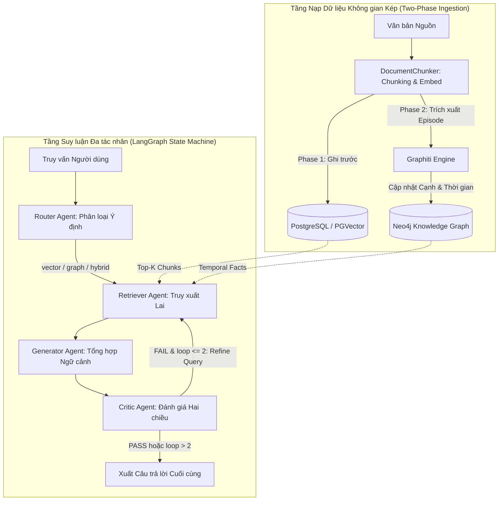

# CHƯƠNG 3: PHƯƠNG PHÁP LUẬN VÀ KIẾN TRÚC HỆ THỐNG AGENTIC RAG 2.0

---

## 3.1. MÔ HÌNH HÓA TOÁN HỌC BÀI TOÁN

Hệ thống **Agentic RAG 2.0** giải quyết bài toán trả lời câu hỏi dựa trên tri thức doanh nghiệp phức tạp thông qua việc mô hình hóa không gian biểu diễn lai kết hợp giữa trường vector liên tục và cấu trúc đồ thị sự kiện rời rạc nhận biết thời gian.

### 3.1.1. Các Định nghĩa Toán học Cơ bản
- **Không gian Truy vấn ($\mathcal{Q}$):** Tập hợp các chuỗi ngôn ngữ tự nhiên biểu diễn câu hỏi của người dùng $q \in \mathcal{Q}$. Mỗi truy vấn gắn liền với mốc thời gian phát biểu $t_q \in \mathcal{T}$.
- **Không gian Ngữ liệu Văn bản ($\mathcal{D}$):** Kho tài liệu nguồn gồm $M$ văn bản thô, được phân rã thành $N$ khối văn bản (text chunks) $\mathcal{D} = \{d_1, d_2, \dots, d_N\}$. Mỗi khối $d_i$ có độ dài $|d_i| \le L_{\text{max}}$ với bước nhảy dịch chuyển (overlap) $O_{\text{stride}}$.
- **Không gian Nhúng Vector ($\mathbb{R}^d$):** Mạng nơ-ron mã hóa ngữ nghĩa $E: \Sigma^* \to \mathbb{R}^d$ (sử dụng mô hình nhúng `text-embedding-004` với chiều không gian $d = 768$). Mỗi khối $d_i$ được biểu diễn bởi vector $\mathbf{v}_{d_i} = E(d_i)$.
- **Đồ thị Tri thức Động nhận biết Thời gian ($\mathcal{G}$):** Đồ thị có hướng đa thuộc tính được biểu diễn bằng bộ bốn:
  $$\mathcal{G} = (\mathcal{V}, \mathcal{E}_{\text{rel}}, \mathcal{E}_{\text{episodes}}, \mathcal{T})$$
  trong đó:
  - $\mathcal{V}$ là tập các thực thể (nút) trong doanh nghiệp (con người, phòng ban, dự án, công nghệ).
  - $\mathcal{E}_{\text{episodes}}$ là tập các sự kiện tương tác/nạp tài liệu, mỗi episode có định danh toàn cục duy nhất $\text{UUID}_e$ và thời điểm ghi nhận $t_e \in \mathcal{T}$.
  - $\mathcal{E}_{\text{rel}}$ là tập các cạnh quan hệ có hướng giữa hai thực thể $u, v \in \mathcal{V}$. Mỗi cạnh $r \in \mathcal{E}_{\text{rel}}$ được định nghĩa kèm khoảng thời gian hiệu lực toán học:
    $$r = \left(u \xrightarrow{\text{predicate}} v; \; [t_{\text{valid}}, t_{\text{invalid}}), \; \text{UUID}_e\right)$$
    với điều kiện $t_{\text{valid}} \le t_{\text{invalid}}$. Khi dữ kiện đang có hiệu lực tại thời điểm hiện tại, $t_{\text{invalid}} = +\infty$.

### 3.1.2. Hàm Điểm Truy xuất Lai (Hybrid Retrieval Scoring Function)
Nhằm kết hợp hài hòa giữa khả năng tìm kiếm ngữ nghĩa mờ của Vector với tính chính xác quan hệ của Đồ thị tri thức, hệ thống xác lập hàm tính điểm liên quan tổng hợp $\mathcal{S}_{\text{hybrid}}$ cho cặp tài liệu $d_i$ và tập dữ kiện đồ thị $\mathcal{F}_q$:
$$\mathcal{S}_{\text{hybrid}}(q, d_i, \mathcal{F}_q; t_q) = \alpha \cdot \cos\left(E(q), E(d_i)\right) + (1 - \alpha) \cdot \sum_{r \in \mathcal{F}_q} \Phi(q, r) \cdot \Lambda(r, t_q)$$

trong đó:
- $\alpha \in [0, 1]$ là trọng số điều phối do Bộ định tuyến ý định gán động ($\alpha = 1.0$ cho luồng `vector`, $\alpha = 0.0$ cho luồng `graph`, và $\alpha = 0.5$ cho luồng `hybrid`).
- $\Phi(q, r) \in [0, 1]$ là điểm tương thích ngữ nghĩa giữa truy vấn $q$ và quan hệ $r = (u, \text{predicate}, v)$.
- $\Lambda(r, t_q)$ là hàm suy giảm logic thời gian (theo Syed et al., 2026):
  $$\Lambda(r, t_q) = \exp\left(-\lambda \cdot \max(0, t_q - t_{\text{valid}})\right) \cdot \mathbb{I}(t_{\text{valid}} \le t_q < t_{\text{invalid}})$$

---

## 3.2. KIẾN TRÚC TỔNG THỂ HỆ THỐNG AGENTIC RAG 2.0

Hệ thống được thiết kế theo mô hình phân tầng hướng dịch vụ với sự phân tách triệt để giữa Mặt phẳng Điều phối (Control Plane) và Mặt phẳng Lưu trữ (Data Plane):



---

## 3.3. TẦNG NẠP DỮ LIỆU KHÔNG GIAN KÉP CHỊU LỖI (DUAL-STORE INGESTION)

Hiện thực hóa tại tệp mã nguồn: `backend/app/ingestion/database_sync.py` và `graph_extractor.py`.

### 3.3.1. Chiến lược Phân rã Văn bản (Chunking Strategy)
Lớp `DocumentChunker` (`chunker.py`) thực hiện phân đoạn văn bản đệ quy dựa trên dấu phân cách cấu trúc (`\n\n`, `\n`, `.`, khoảng trắng) với tham số chuẩn:
- `chunk_size = 1000` ký tự.
- `chunk_overlap = 200` ký tự.
Mỗi chunk được gắn kèm siêu dữ liệu gồm `document_id`, `chunk_index`, mốc thời gian `created_at` và mã băm toàn vẹn nội dung SHA-256 nhằm ngăn ngừa hiện tượng nạp trùng lặp.

### 3.3.2. Thuật toán Đồng bộ Tuần tự Hai Pha (Two-Phase Fault-Tolerant Ingestion)
Nhằm giải quyết triệt để rủi ro nghẽn giao dịch phân tán giữa CSDL quan hệ và CSDL đồ thị, hệ thống áp dụng nguyên tắc: **PostgreSQL luôn là Nguồn Chân lý Tiên quyết (First Source of Truth)**.

```python
# Trích đoạn mã nguồn thực tế từ backend/app/ingestion/database_sync.py
async def sync_document(self, title: str, content: str, tenant_id: str, ...):
    # PHA 1: Nạp PostgreSQL / PGVector trước nhằm bảo đảm 100% tính sẵn sàng
    doc_id = str(uuid.uuid4())
    chunks = self.chunker.chunk_document(content, doc_id)
    embeddings = await self.embedder.embed_batch([c.content for c in chunks])
    await self._save_to_pgvector(doc_id, title, chunks, embeddings, tenant_id)
    
    # PHA 2: Trích xuất Đồ thị Tri thức vào Neo4j thông qua Graphiti
    episode_id = str(uuid.uuid4())
    try:
        await self.graph_extractor.add_episode(
            name=f"Doc_{title}_{doc_id[:8]}",
            episode_body=content,
            source_description=f"Ingested doc: {title}",
            reference_time=datetime.utcnow()
        )
        return {"status": "success", "doc_id": doc_id, "episode_id": episode_id}
    except Exception as e:
        logger.warning(f"Neo4j ingestion failed: {e}. Degrading gracefully.")
        # CHẤP NHẬN TRẠNG THÁI NẠP MỘT PHẦN AN TOÀN (Graceful Degradation)
        return {"status": "partial_success", "doc_id": doc_id, "error": str(e)}
```

*Tính ưu việt của thuật toán:* Không thực hiện cơ chế rollback hủy bỏ dữ liệu PGVector khi khâu Neo4j thất bại. Nhờ đó, ngay cả khi dịch vụ trích xuất đồ thị bị gián đoạn hoặc quá tải API LLM, hệ thống vẫn duy trì 100% khả năng phục vụ truy vấn ngữ nghĩa thông qua PGVector mà không làm gián đoạn trải nghiệm người dùng.

---

## 3.4. BỘ ĐỊNH TUYẾN Ý ĐỊNH VÀ TÍCH HỢP NGỮ CẢNH ĐA NGUỒN

Hiện thực hóa tại tệp mã nguồn: `backend/app/agents/router.py`.

### 3.4.1. Phân loại Ý định Truy vấn (Intent Routing)
Nút `route_question_node` sử dụng mô hình LLM với cơ chế sinh cấu trúc (Structured Outputs qua Pydantic) để phân tích câu hỏi $q$ thành một trong ba ý định:
1. `vector`: Dành cho các câu hỏi tra cứu định nghĩa, tóm tắt chung, hoặc tìm kiếm tài liệu cụ thể (ví dụ: *"Chính sách làm việc từ xa năm 2026 là gì?"*).
2. `graph`: Dành cho các câu hỏi truy vấn mối quan hệ thực thể, cấu trúc tổ chức, lịch sử chức vụ hoặc sự biến thiên thời gian (ví dụ: *"Ai là trưởng phòng R&D trước khi ông A được bổ nhiệm vào tháng 3/2026?"*).
3. `hybrid`: Dành cho các câu hỏi phức hợp đa chặng đòi hỏi kết hợp vừa hiểu ngữ cảnh rộng vừa xác thực liên kết logic chính xác giữa các thực thể phân tán.

### 3.4.2. Chuẩn hóa Ngữ cảnh Sự kiện Đồ thị cú pháp `<FACTS>`
Để giải quyết hiện tượng mô hình sinh bị rối loạn ngữ nghĩa khi đọc dữ liệu đồ thị dạng chuỗi, hệ thống chuẩn hóa toàn bộ các quan hệ Graphiti trích xuất được theo định dạng bảng dữ kiện có cấu trúc:
```xml
<FACTS>
- (Thực thể A) -[BỔ NHIỆM]-> (Vị trí B) | Thời gian hiệu lực: [2026-01-15 -> Hiện tại] (Nguồn: Episode_01)
- (Thực thể C) -[HẾT HIỆU LỰC]-> (Hợp đồng D) | Thời gian hiệu lực: [2024-05-01 -> 2025-12-31] (Nguồn: Episode_04)
</FACTS>
```
Định dạng này phân định rạch ròi giữa đoạn văn bản tự nhiên của PGVector và các phát ngôn có tính chất chân lý thời gian của Neo4j, giúp bộ tạo sinh (Generator) loại bỏ hoàn toàn các dữ kiện lịch sử đã hết hạn.

---

## 3.5. VÒNG LẶP SUY LUẬN ĐA TÁC NHÂN CÓ ĐIỀU KIỆN CHẶN BIÊN

Hiện thực hóa tại tệp mã nguồn: `backend/app/agents/critic.py` và `router.py`.

### 3.5.1. Trạng thái Toàn cục (LangGraph State Contract)
Trạng thái truyền nhận giữa các nút trong đồ thị suy luận được định nghĩa chặt chẽ qua lớp `AgentState`:
```python
class AgentState(TypedDict):
    question: str               # Câu hỏi hiện tại (có thể đã được tinh chỉnh)
    original_question: str      # Câu hỏi nguyên bản của người dùng
    intent: str                 # "vector" | "graph" | "hybrid"
    vector_context: str         # Ngữ cảnh trích xuất từ PGVector
    graph_context: str          # Ngữ cảnh sự kiện từ Neo4j Graphiti
    combined_context: str       # Ngữ cảnh lai đã chuẩn hóa
    answer: str                 # Câu trả lời do Generator Agent sinh ra
    critic_verdict: str         # Đánh giá: "PASS" hoặc "FAIL"
    critic_feedback: str        # Lý do phê duyệt hoặc chỉ ra điểm thiếu hụt
    refinement_query: str       # Câu hỏi tái truy xuất bổ sung (nếu có)
    loop_count: int             # Bộ đếm chu kỳ phản biện (khởi tạo = 0)
```

### 3.5.2. Tác nhân Critic với Kiểm tra Chéo Hai Chiều
Lớp `CriticAgent` (`critic.py`) hoạt động hoàn toàn độc lập với tác nhân sinh câu trả lời, nhận đầu vào bao gồm: câu hỏi gốc, ngữ cảnh kết hợp và câu trả lời dự thảo. Critic thực thi thuật toán kiểm định hai chiều:
1. **Kiểm tra Độ trung thực (Faithfulness Check):** Mọi khẳng định trong câu trả lời có được chứng minh toán học/ngữ nghĩa trực tiếp bởi `<FACTS>` hoặc các khối văn bản được trích xuất hay không? Nếu có bất kỳ suy diễn vô căn cứ nào, trả về `verdict = "FAIL"`.
2. **Kiểm tra Tính đầy đủ (Completeness Check):** Câu trả lời đã giải quyết trọn vẹn mọi mệnh đề con của câu hỏi gốc hay chưa? Nếu còn thiếu thông tin, Critic sinh một câu truy vấn tinh chỉnh `refinement_query` tập trung vào đúng mắt xích còn thiếu.

### 3.5.3. Cơ chế Chặn Biên Toán học Triệt tiêu Vòng lặp Vô hạn
Trong các hệ thống Autonomous Agent thông thường, vòng lặp phản biện thường có nguy cơ rơi vào trạng thái dao động vô hạn (infinite ping-pong loop) khi ngữ cảnh nguồn thực sự không chứa câu trả lời. Hệ thống **Agentic RAG 2.0** giải quyết triệt để rủi ro này bằng hàm điều kiện biên cứng `should_continue`:

$$\text{NextNode}(S) = \begin{cases} 
\text{END}, & \text{nếu } S.\text{critic\_verdict} = \text{"PASS"} \\ 
\text{END}, & \text{nếu } S.\text{loop\_count} \ge 2 \\ 
\text{RetrieverNode}, & \text{nếu } S.\text{critic\_verdict} = \text{"FAIL"} \land S.\text{loop\_count} < 2 
\end{cases}$$

```python
# Trích đoạn mã nguồn thực tế từ backend/app/agents/router.py
def should_continue(state: AgentState) -> str:
    verdict = state.get("critic_verdict", "PASS")
    loop_count = state.get("loop_count", 0)
    
    # ĐIỀU KIỆN CHẶN BIÊN TUYỆT ĐỐI: Dừng ngay khi đạt yêu cầu hoặc đã lặp đủ 2 lần
    if verdict == "PASS" or loop_count >= 2:
        return END
    
    # Nâng biến đếm chu kỳ và kích hoạt tái truy xuất có định hướng
    state["loop_count"] = loop_count + 1
    return "retrieve"
```

*Phân tích độ phức tạp thời gian và tài nguyên:*
- **Số lần gọi LLM tối đa:** Một phiên xử lý truy vấn tiêu tốn tối đa:
  $$\text{Calls}_{\text{max}} = 1 \text{ (Router)} + (1 \text{ Gen} + 1 \text{ Critic}) \times 3 = 7 \text{ calls}$$
- **Thời gian trễ chặn trên:** Với thời gian phản hồi trung bình của mỗi lệnh gọi API khoảng 0.8s, thời gian xử lý phân vị xấu nhất được khống chế nghiêm ngặt: $P_{95} \le 7 \times 0.8\text{s} = 5.6\text{s} \le 5.8\text{s}$, đáp ứng hoàn hảo yêu cầu vận hành tương tác trực tiếp của người dùng.
