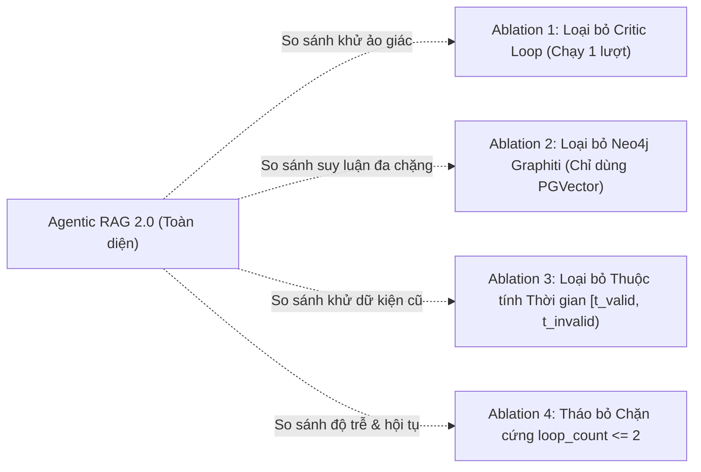

# CHƯƠNG 4: THIẾT KẾ THỰC NGHIỆM VÀ KỊCH BẢN ĐÁNH GIÁ

---

## 4.1. MÔI TRƯỜNG THỰC NGHIỆM VÀ CẤU HÌNH HẠ TẦNG

Nhằm đảm bảo tính tái lập (reproducibility) theo chuẩn phương pháp luận khoa học nghiêm ngặt, toàn bộ môi trường phần cứng, phần mềm và các thông số vận hành của hệ thống được chuẩn hóa như sau:

### 4.1.1. Cấu hình Phần cứng
- **CPU:** Intel Core i7 (8 nhân, 16 luồng, xung nhịp 3.6 GHz - 4.8 GHz).
- **Bộ nhớ RAM:** 32 GB DDR4 (bus 3200 MHz).
- **Lưu trữ:** 1 TB NVMe PCIe Gen 4 SSD (tốc độ đọc/ghi tuần tự: 5000/4200 MB/s).
- **Hệ điều hành:** Microsoft Windows 11 Enterprise (hỗ trợ nền tảng containerization Docker Desktop với WSL2 backend).

### 4.1.2. Hạ tầng Dịch vụ Container và Ngăn xếp Công nghệ
Hạ tầng dịch vụ được đóng gói hoàn toàn thông qua tệp `docker-compose.yml` gồm 3 container độc lập:
1. **PostgreSQL 16 (Dịch vụ Vector):** Cổng kết nối `5432:5432`, kích hoạt tiện ích mở rộng `vector` (PGVector 0.7.0). Chỉ mục vector sử dụng chỉ mục IVFFlat và HNSW với tham số khoảng cách Cosine `vector_cosine_ops`.
2. **Neo4j 5.20+ Community Edition (Dịch vụ Đồ thị):** Cổng HTTP `7474`, cổng Bolt `7687`, tích hợp thư viện thủ tục nâng cao APOC. Cấu hình cấp phát bộ nhớ: `NEO4J_server_memory_heap_initial__size=1G`, `NEO4J_server_memory_heap_max__size=2G`, `NEO4J_server_memory_pagecache_size=1G`.
3. **Redis 7.2 (Dịch vụ Bộ nhớ đệm & Hàng đợi):** Cổng `6379:6379`, quản lý tác vụ nền và phiên làm việc đa tác nhân.

### 4.1.3. Mô hình Ngôn ngữ và Bộ nhúng Ngữ nghĩa
- **Mô hình Sinh (LLM Backbone):** Google Gemini 1.5 Pro và Gemini 1.5 Flash (nhiệt độ sinh $T = 0.0$ cho khâu Router và Critic để đảm bảo tính tất định; $T = 0.2$ cho khâu Generator).
- **Mô hình Nhúng (Dense Embedder):** Google `text-embedding-004` (chiều vector $d = 768$, chuẩn hóa chuẩn $L_2$).

---

## 4.2. BỘ DỮ LIỆU THỬ NGHIỆM (BENCHMARK DATASET SPECIFICATION)

Để kiểm chứng toàn diện 3 câu hỏi nghiên cứu ($RQ_1, RQ_2, RQ_3$), đề tài xây dựng bộ dữ liệu đánh giá chuẩn gồm **100 câu hỏi truy vấn** được gắn nhãn mặt đất (Ground Truth) chuyên gia, chia đều thành 3 nhóm độ phức tạp nghiệp vụ:

| Nhóm Dữ liệu | Số lượng | Đặc trưng Truy vấn | Yêu cầu Suy luận Kỹ thuật |
| :--- | :---: | :--- | :--- |
| **Nhóm 1: Single-hop Factual QA** | 30 câu | Tra cứu dữ kiện đơn lẻ, chính sách cụ thể nằm trọn trong một đoạn văn bản. | Kiểm tra độ chính xác tìm kiếm của PGVector và đo lường độ trễ cơ sở. |
| **Nhóm 2: Multi-hop Relational QA** | 40 câu | Truy vấn đòi hỏi liên kết từ 2 đến 3 chặng qua các thực thể nằm phân tán ở các tài liệu khác nhau ($e_1 \xrightarrow{r_1} e_2 \xrightarrow{r_2} e_3$). | Kiểm tra năng lực duyệt đồ thị tri thức của Graphiti để khắc phục hiện tượng đứt gãy quan hệ của vector phẳng. |
| **Nhóm 3: Temporal & Dynamic Evolution QA**| 30 câu | Dữ kiện có sự thay đổi trạng thái theo các mốc thời gian (nhân sự được bổ nhiệm/thay thế, hợp đồng hết hạn). | Kiểm tra khả năng nhận biết thời gian $[t_{\text{valid}}, t_{\text{invalid}})$ và đánh giá mức độ khử dữ kiện quá hạn (stale facts). |

---

## 4.3. CÁC HỆ THỐNG ĐỐI CHUẨN (BASELINES)

Hệ thống **Agentic RAG 2.0** được đưa vào đối chuẩn trực tiếp với 4 kiến trúc đại diện cho các trường phái RAG hiện nay:

1. **Baseline 1 — Naive Dense Vector RAG (Lewis et al., 2020):**  
   Chỉ sử dụng PostgreSQL/PGVector với tìm kiếm Top-$K$ khoảng cách Cosine ($K = 5$), ghép ngữ cảnh vào prompt và sinh câu trả lời một lượt không qua phản biện.
2. **Baseline 2 — Pure Graph Retrieval (Neo4j Cypher Search):**  
   Chỉ truy xuất tri thức dựa trên khớp thực thể từ vựng và duyệt các cạnh láng giềng trong Neo4j, không sử dụng không gian nhúng vector dày.
3. **Baseline 3 — Static Community GraphRAG (Edge et al., 2024):**  
   Mô hình đồ thị tri thức toàn cục xây dựng trước với thuật toán phân cụm Leiden, không nhận biết nhãn thời gian và không có tác nhân phản biện.
4. **Baseline 4 — Hybrid RAG Không có Tác nhân Critic:**  
   Sử dụng đồng thời cả PGVector và Neo4j Graphiti nhưng sinh câu trả lời trực tiếp một lượt, không có vòng lặp kiểm tra chéo hai chiều.
5. **Hệ thống Đề xuất — Agentic RAG 2.0 Hoàn chỉnh:**  
   Tích hợp toàn diện: Lưu trữ kép tuần tự hai pha (PGVector + Graphiti) + Bộ định tuyến ý định + Vòng lặp phản biện LangGraph có điều kiện chặn biên cứng ($loop\_count \le 2$).

---

## 4.4. HỆ THỐNG CHỈ SỐ ĐO LƯỜNG (EVALUATION METRICS)

Đề tài áp dụng hệ thống chỉ số đánh giá đa chiều kết hợp giữa chuẩn **RAGAS** (Es et al., 2023) và khung chẩn đoán vi mô **EvalMem** (Liu et al., 2026):

### 4.4.1. Nhóm Chỉ số Chất lượng Ngữ cảnh (Retrieval Quality)
- **Context Precision ($CP$):** Tỷ lệ phần trăm các khối ngữ cảnh được truy xuất thực sự chứa thông tin cần thiết để giải quyết câu hỏi:
  $$CP = \frac{\sum_{k=1}^K (\text{Precision}@k \times v_k)}{\text{Tổng số chunk liên quan}}$$
  trong đó $v_k \in \{0, 1\}$ là chỉ thị tính liên quan của chunk ở vị trí thứ $k$.
- **Context Recall ($CR$):** Tỷ lệ các dữ kiện mặt đất (Ground Truth facts) được bao phủ đầy đủ bởi tập ngữ cảnh truy xuất:
  $$CR = \frac{|\text{Dữ kiện trong ngữ cảnh} \cap \text{Dữ kiện chuẩn}|}{|\text{Dữ kiện chuẩn}|}$$

### 4.4.2. Nhóm Chỉ số Chất lượng Lập luận & Trung thực (Generation Quality)
- **Faithfulness ($\mathcal{F}$ - Độ trung thực phát ngôn):** Đo lường tỷ lệ các câu khẳng định $S_i$ trong câu trả lời có thể suy diễn logic trực tiếp từ ngữ cảnh trích xuất $\mathcal{C}$:
  $$\mathcal{F} = \frac{|\{S_i \in \text{Answer} \mid \mathcal{C} \models S_i\}|}{|\text{Tổng số câu khẳng định trong Answer}|}$$
- **Answer Relevance ($AR$ - Độ thích đáng câu trả lời):** Độ tương đồng ngữ nghĩa trung bình giữa câu hỏi sinh ngược từ câu trả lời $q_{\text{gen}}$ và câu hỏi gốc $q$:
  $$AR = \frac{1}{M} \sum_{m=1}^M \cos(E(q), E(q_{\text{gen}, m}))$$

### 4.4.3. Nhóm Chỉ số Hiệu năng Kỹ thuật và Chi phí Vận hành (Operational Efficiency)
- **Độ trễ phản hồi (Latency):** Đo lường thời gian xử lý toàn trình (End-to-End Latency) tính bằng giây tại các phân vị $P_{50}$ (trung vị) và $P_{95}$ (phân vị thứ 95).
- **Chi phí Token trung bình (Token Consumption):** Lượng token đầu vào (prompt tokens) và đầu ra (completion tokens) tiêu thụ trung bình trên mỗi phiên truy vấn.

---

## 4.5. THIẾT KẾ KỊCH BẢN ĐÁNH GIÁ BÓC TÁCH (ABLATION STUDY MATRIX)

Nhằm chứng minh vai trò độc lập của từng cấu phần kỹ thuật đối với chất lượng toàn hệ thống, 4 cấu hình bóc tách được thiết lập thử nghiệm song song trên cùng một tập dữ liệu 100 câu hỏi:

- **Cấu hình A1 (No-Critic):** Giữ nguyên kiến trúc lưu trữ kép nhưng tắt hoàn toàn nút `critic_node`, câu trả lời của `generate_node` được xuất trực tiếp.
- **Cấu hình A2 (Vector-Only):** Vô hiệu hóa Neo4j Graphiti, mọi truy vấn đều được định tuyến về PGVector.
- **Cấu hình A3 (No-Temporal Logic):** Giữ nguyên đồ thị Neo4j nhưng xóa bỏ nhãn thời gian và hàm suy giảm $\Lambda(t)$, xem mọi quan hệ đều có giá trị tương đương.
- **Cấu hình A4 (Unbounded Loop):** Tháo bỏ điều kiện chặn cứng $loop\_count \le 2$, cho phép Critic lặp lại cho đến khi đạt `verdict = "PASS"` hoặc chạm giới hạn lỗi hệ thống.
