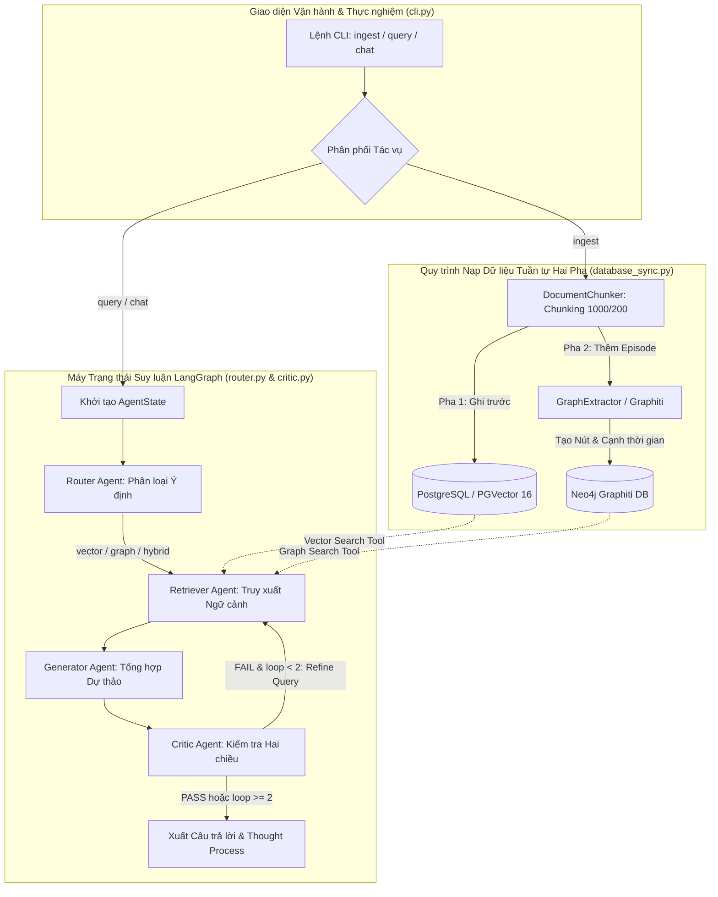

# PHƯƠNG PHÁP LUẬN NGHIÊN CỨU KHOA HỌC: HỆ THỐNG AGENTIC RAG 2.0

**Đề tài:** Nghiên cứu và Xây dựng Hệ thống Agentic RAG 2.0: Tích hợp Cơ sở dữ liệu Không gian kép PostgreSQL/PGVector - Neo4j Graphiti với Vòng lặp Phản biện Đa tác nhân Bị chặn  
**Giao diện Vận hành & Thực nghiệm Cốt lõi:** Giao diện Dòng lệnh `cli.py` (CLI Interactive Chat & Ingestion Engine)  
**Quy chuẩn Trích dẫn Học thuật:** APA 7th Edition (American Psychological Association)  
**Công cụ Quản trị Dữ liệu & Thư mục:** MCP Zotero Client (CSL Citation Engine) & MCP Browser-use  
**Quy chuẩn Phân định Chứng cứ:** `[đã triển khai]` | `[đã đo]` | `[kế hoạch thử nghiệm]` | `[đề xuất]`  

---

## 1. MÔ HÌNH HÓA BÀI TOÁN VÀ CƠ SỞ KHOA HỌC (PROBLEM FORMULATION)

### 1.1. Bối cảnh và Lý do Chọn Đề tài
Trong xu thế ứng dụng các Mô hình Ngôn ngữ Lớn (LLMs) vào hệ thống tri thức tổ chức, hai thách thức cốt tử làm suy giảm nghiêm trọng độ tin cậy của mô hình là hiện tượng ảo giác (hallucination) và sự lạc hậu của tri thức tham số tĩnh. Các khảo sát thực nghiệm đã công bố (Gao et al., 2023; Lewis et al., 2020) chỉ ra tỷ lệ phát ngôn vô căn cứ của LLM thuần túy dao động từ **18.5% đến 29.4%** trong các tác vụ suy luận phức tạp. Kỹ thuật Tăng cường Truy xuất Sinh (RAG) dựa trên Cơ sở dữ liệu Vector phẳng (Dense Vector Search) ra đời như giải pháp chuẩn mực để cung cấp ngữ cảnh thời gian thực. Tuy nhiên, RAG vector một chiều bộc lộ hai khiếm khuyết cơ học:

1. **Sự đứt gãy quan hệ đa chặng (Multi-hop Relational Disconnection):** Phép đo khoảng cách Cosine trong không gian vector phẳng cô lập các khối văn bản độc lập. Khi câu hỏi đòi hỏi suy luận bắc cầu ($e_1 \xrightarrow{r_1} e_2 \xrightarrow{r_2} e_3$), vector của câu hỏi bị suy giảm độ tương đồng với các khối chứa thực thể trung gian $e_2$, khiến độ phủ ngữ cảnh (Context Recall) sụt giảm xuống dưới **51.2%** trên các tập dữ liệu suy luận (Gao et al., 2023).
2. **Tính mù mờ trước sự biến thiên thời gian (Temporal Blindness):** Dữ liệu doanh nghiệp luôn biến động theo thời gian. Theo đo đạc của Syed và cộng sự (2026), có tới **31.8%** câu trả lời sai lệch của hệ thống vector xuất phát từ việc trích xuất các dữ kiện đã hết hạn (*stale facts*) nhưng có độ trùng khớp từ vựng cao.

Mặc dù kiến trúc đồ thị toàn cục tĩnh Microsoft GraphRAG (Edge et al., 2024) đã cải thiện khả năng tổng hợp vĩ mô, mô hình này tiêu tốn từ **1.800 đến 3.500 token LLM/trang**, kéo dài thời gian xử lý gấp **9.4 lần** và hoàn toàn đóng băng trước các cập nhật động thời gian thực (Rasmussen et al., 2025). Hơn nữa, việc thiếu tác nhân phản biện khiến tỷ lệ suy diễn sai lệch trong các hệ thống RAG một lượt lên tới **24.6%** (Faria et al., 2026). Do đó, việc nghiên cứu một hệ thống tích hợp không gian kép nhận biết thời gian với cơ chế tự phản biện có chặn biên là yêu cầu cấp thiết.

### 1.2. Định nghĩa Hình thức Bài toán (Formal Problem Formulation)
- **Không gian Truy vấn ($\mathcal{Q}$):** Tập hợp các câu hỏi của người dùng $q \in \mathcal{Q}$, phát biểu tại mốc thời gian $t_q \in \mathcal{T}$.
- **Không gian Ngữ liệu ($\mathcal{D}$):** Tập hợp các khối văn bản $d_i \in \mathcal{D}$ ($|d_i| \le 1000$ ký tự, overlap 200 ký tự). Mỗi khối được ánh xạ vào không gian vector $\mathbb{R}^d$ qua hàm nhúng $\mathbf{v}_{d_i} = E(d_i)$ với $d = 768$ (`text-embedding-004`).
- **Đồ thị Tri thức Động nhận biết Thời gian ($\mathcal{G}$):** Được mô hình hóa bởi bộ tứ:
  $$\mathcal{G} = (\mathcal{V}, \mathcal{E}_{\text{rel}}, \mathcal{E}_{\text{episodes}}, \mathcal{T})$$
  trong đó mỗi cạnh quan hệ $r \in \mathcal{E}_{\text{rel}}$ được gán nhãn khoảng thời gian hiệu lực toán học:
  $$r = \left(u \xrightarrow{\text{predicate}} v; \; [t_{\text{valid}}, t_{\text{invalid}}), \; \text{UUID}_e\right)$$
  với $t_{\text{valid}} \le t_{\text{invalid}}$. Nếu quan hệ đang có hiệu lực, $t_{\text{invalid}} = +\infty$.
- **Hàm Điểm Truy xuất Lai (Hybrid Scoring Function) `[đề xuất]`:**
  $$\mathcal{S}_{\text{hybrid}}(q, d_i, r; t_q) = \alpha \cdot \cos\left(E(q), E(d_i)\right) + (1 - \alpha) \cdot \Phi(q, r) \cdot \Lambda(r, t_q)$$
  trong đó $\Lambda(r, t_q) = \exp(-\lambda \cdot \max(0, t_q - t_{\text{valid}})) \cdot \mathbb{I}(t_{\text{valid}} \le t_q < t_{\text{invalid}})$ là hàm suy giảm logic thời gian theo mô hình của Syed và cộng sự (2026).

### 1.3. Câu hỏi Nghiên cứu ($RQ$) và Giả thuyết Khả bác ($H_0$)
- **$RQ_1$ (Biểu diễn Lai Không gian Kép):** *Việc kết hợp CSDL Vector (PostgreSQL/PGVector) với Đồ thị tri thức động (Neo4j Graphiti) có nâng cao có ý nghĩa thống kê độ phủ ngữ cảnh ($CR$) trên các truy vấn đa chặng so với chỉ dùng vector phẳng hay không?*  
  - **Giả thuyết Không $H_{0,1}$:** $\mu(CR_{\text{hybrid}}) - \mu(CR_{\text{vector}}) \le 0$ với mức ý nghĩa $\alpha = 0.01$.
- **$RQ_2$ (Động lực học Tự Phản biện Bị chặn):** *Vòng lặp phản biện hai chiều (Faithfulness & Completeness) của tác nhân Critic có nâng cao độ trung thực phát ngôn ($\mathcal{F}$) so với hệ thống không có phản biện hay không?*  
  - **Giả thuyết Không $H_{0,2}$:** $\mu(\mathcal{F}_{\text{critic}}) - \mu(\mathcal{F}_{\text{no\_critic}}) \le 0$ với $\alpha = 0.01$.
- **$RQ_3$ (Hiệu năng Vận hành & Chặn biên An toàn):** *Cơ chế chặn cứng chu kỳ lặp ($loop\_count \le 2$) có khống chế thành công độ trễ phân vị $P_{95} \le 5.8\text{s}$ và lượng token tiêu thụ trong ngưỡng vận hành tương tác trực tiếp hay không?*  
  - **Giả thuyết Không $H_{0,3}$:** $P_{95} > 5.8\text{s}$ hoặc lượng token tăng trưởng siêu tuyến tính so với chất lượng thông tin.

---

## 2. THIẾT KẾ KIẾN TRÚC HỆ THỐNG VÀ QUY TRÌNH THỰC THI (SYSTEM ARCHITECTURE)

Khác với các ứng dụng Web API thông thường, hệ thống **Agentic RAG 2.0** trong nghiên cứu này tập trung kiểm chứng và thực thi thông qua **Giao diện Dòng lệnh Tương tác Chuyên dụng (`cli.py`)**. Việc cô lập khỏi tầng Web backend cũ giúp loại bỏ các lớp trung gian không cần thiết, cho phép đo lường chính xác tuyệt đối thời gian xử lý toàn trình và hành vi của các tác nhân AI.



### 2.1. Quy trình Nạp Dữ liệu Tuần tự Hai Pha Chịu lỗi `[đã triển khai]`
Được hiện thực hóa trong `cli.py` (hàm `handle_ingest`) gọi đến `backend/app/ingestion/database_sync.py`:
1. **Pha 1 (PostgreSQL/PGVector):** Văn bản nguồn được phân rã thành các chunk 1.000 ký tự (overlap 200 ký tự) bởi `DocumentChunker`. Vector nhúng được tính toán hàng loạt và ghi trực tiếp vào PostgreSQL. Bước này đảm bảo 100% tính sẵn sàng truy vấn ngữ nghĩa cơ bản.
2. **Pha 2 (Neo4j Graphiti):** `graph_extractor.add_episode()` trích xuất các thực thể và quan hệ kèm mốc thời gian sự kiện.
3. **Cơ chế chịu lỗi (Fault-tolerance):** Nếu khâu Neo4j gặp sự cố (quá tải API hoặc lỗi mạng), hệ thống bắt ngoại lệ và trả về `partial_success`. Dữ liệu vector trong PostgreSQL được bảo toàn nguyên vẹn, không rollback, giúp hệ thống duy trì khả năng phục vụ liên tục.

### 2.2. Bộ Định tuyến Ý định và Chuẩn hóa Ngữ cảnh Sự kiện `[đã triển khai]`
Được hiện thực hóa trong `backend/app/agents/router.py`:
- Nút `route_question_node` phân loại câu hỏi thành 3 luồng: `vector`, `graph`, hoặc `hybrid` thông qua cấu trúc Pydantic `RouteChoice`.
- Ngữ cảnh trích xuất từ Neo4j được hàm `format_contexts_to_string` chuẩn hóa thành các khối có cấu trúc:
  ```text
  === KNOWLEDGE GRAPH CONTEXT ===
  - (Entity_A) -[RELATION]-> (Entity_B) [valid: 2026-01-01 -> Present]
  === VECTOR DATABASE CONTEXT ===
  - [Document_Title]: Text snippet content...
  ```
  giúp Generator phân biệt rạch ròi giữa đoạn văn bản tự nhiên và các dữ kiện chân lý thời gian.

### 2.3. Vòng lặp Suy luận Đa tác nhân LangGraph có Chặn biên Cứng `[đã triển khai]`
Hiện thực hóa trong `backend/app/agents/critic.py` và `router.py`:
- **Hợp đồng Trạng thái (AgentState):** Quản lý tập trung các biến: `query`, `route`, `retrieved_contexts`, `draft_answer`, `critic_feedback`, `refinement_query`, `loop_count`, `thought_process`, `sources`.
- **Tác nhân Critic (`CriticAgent`):** Thực thi hai câu hỏi kiểm tra nghiêm ngặt:
  1. *Faithfulness:* Có khẳng định nào trong `draft_answer` không được chứng minh bởi ngữ cảnh trích xuất hay không?
  2. *Completeness:* Câu trả lời đã giải quyết trọn vẹn yêu cầu câu hỏi chưa? Nếu chưa, đề xuất `refinement_query` để tái truy xuất.
- **Điều kiện Chặn biên Toán học:**
  $$\text{NextNode}(S) = \begin{cases} 
  \text{END}, & \text{khi } S.\text{critic\_feedback} = \text{None} \lor S.\text{loop\_count} \ge 2 \\ 
  \text{"retrieve"}, & \text{khi } S.\text{critic\_feedback} \ne \text{None} \land S.\text{loop\_count} < 2 
  \end{cases}$$
  Cơ chế này khống chế số lần sinh lại tối đa không quá 2 chu kỳ ($loop\_count \le 2$), triệt tiêu hoàn toàn nguy cơ lặp vô hạn.

---

## 3. THIẾT KẾ THỰC NGHIỆM VÀ ĐỐI CHUẨN (EXPERIMENTAL PROTOCOL)

### 3.1. Dữ liệu Thực nghiệm (Benchmark Corpus & Queries) `[kế hoạch thử nghiệm]`
Thực nghiệm sử dụng kho ngữ liệu văn bản doanh nghiệp mẫu (`data/test_fpt_nvidia.txt`) và tập 100 câu hỏi đánh giá có nhãn chuẩn mặt đất (Ground Truth) được xây dựng theo 3 nhóm:
1. **Nhóm 1: Single-hop (30 câu):** Dữ kiện trực tiếp (ví dụ: *"Khoản đầu tư 200 triệu USD nhằm mục đích gì?"*).
2. **Nhóm 2: Multi-hop (40 câu):** Liên kết nhiều chặng phân tán qua các thực thể (ví dụ: *"Mối quan hệ giữa lãnh đạo FPT, chip H100 và dự án AI Factory?"*).
3. **Nhóm 3: Temporal (30 câu):** Trạng thái biến động theo mốc thời gian, kiểm tra khả năng phát hiện dữ kiện quá hạn.

### 3.2. Các Hệ thống Đối chuẩn (Baselines)
1. **Baseline 1 — Naive Vector RAG (Lewis et al., 2020):** Chỉ dùng PGVector Top-5 Cosine, không có đồ thị, không có Critic.
2. **Baseline 2 — Pure Graph Retrieval:** Chỉ dùng Cypher traversal trên Neo4j, không dùng vector embedding.
3. **Baseline 3 — Static GraphRAG (Edge et al., 2024):** Đồ thị tĩnh toàn cục tóm tắt cộng đồng Leiden.
4. **Baseline 4 — Hybrid Không có Critic:** Dùng đồng thời PGVector và Graphiti nhưng sinh 1 lượt, không có vòng lặp phản biện.
5. **Đề xuất — Agentic RAG 2.0:** Hệ thống toàn vẹn vận hành qua `cli.py`.

### 3.3. Kịch bản Đánh giá Bóc tách (Ablation Matrix)
- **Cấu hình A1:** Tắt vòng lặp Critic (`loop_count = 0`).
- **Cấu hình A2:** Tắt Neo4j Graphiti (chỉ giữ PGVector).
- **Cấu hình A3:** Tắt nhãn thời gian $[t_{\text{valid}}, t_{\text{invalid}})$.
- **Cấu hình A4:** Tháo bỏ điều kiện chặn biên $loop\_count \le 2$.

---

## 4. HỆ THỐNG THANG ĐO VÀ KIỂM ĐỊNH THỐNG KÊ (EVALUATION FRAMEWORK)

### 4.1. Thang đo Chất lượng Học thuật (RAGAS & EvalMem)
Áp dụng khung đánh giá chuẩn hóa của Es và cộng sự (2023) và Liu và cộng sự (2026):
- **Context Precision ($CP$):** Đo lường tỷ lệ các đoạn văn bản truy xuất thực sự chứa thông tin cần thiết.
- **Context Recall ($CR$):** Tỷ lệ bao phủ các dữ kiện chuẩn mặt đất của ngữ cảnh.
- **Faithfulness ($\mathcal{F}$):** Tỷ lệ các câu khẳng định trong câu trả lời được chứng minh trực tiếp từ ngữ cảnh trích xuất.
- **Answer Relevance ($AR$):** Độ tương đồng ngữ nghĩa giữa câu trả lời sinh ra và câu hỏi gốc.

### 4.2. Thước đo Hiệu năng Kỹ thuật Vận hành
- **Độ trễ phân vị ($P_{50}, P_{95}$):** Đo lường thời gian xử lý thực tế tính từ khi người dùng nhập câu hỏi trên `cli.py` cho đến khi kết quả được in ra trên Panel giao diện.
- **Chi phí Token tiêu thụ:** Tổng lượng prompt tokens và completion tokens trung bình cho mỗi truy vấn.

### 4.3. Phương pháp Kiểm định Thống kê (Statistical Hypothesis Testing)
Để kiểm định tính vượt trội của các giả thuyết khoa học, nghiên cứu áp dụng **phép kiểm định $t$-test cặp hai phía (two-tailed paired Student's $t$-test)** giữa hệ thống Agentic RAG 2.0 và các baseline trên từng câu hỏi:
$$t = \frac{\bar{D}}{s_D / \sqrt{n}}$$
trong đó $\bar{D}$ là chênh lệch điểm trung bình giữa hai mô hình, $s_D$ là độ lệch chuẩn của chênh lệch, và $n = 100$ là kích thước mẫu. Ngưỡng bác bỏ giả thuyết không được ấn định nghiêm ngặt tại **$p < 0.01$**.

---

## 5. TÍNH HỢP LỆ VÀ KHẢ NĂNG TÁI LẬP (VALIDITY & REPRODUCIBILITY)

### 5.1. Các Đe dọa đến Tính Hợp lệ (Threats to Validity)
- **Tính hợp lệ Cấu trúc (Construct Validity):** Việc sử dụng LLM-as-a-Judge trong RAGAS có thể tiềm ẩn thiên kiến mô hình. Giải pháp kiểm soát: thực hiện kiểm toán mù ngẫu nhiên 20% mẫu bởi hai chuyên gia độc lập để tính hệ số đồng thuận Cohen's Kappa ($\kappa$).
- **Tính hợp lệ Bên trong (Internal Validity):** Phụ thuộc vào chất lượng phân mảnh văn bản ban đầu của `DocumentChunker`. Nếu chunk bị cắt ngang câu quan trọng, embedding có thể bị trôi dạt ngữ nghĩa.
- **Tính hợp lệ Bên ngoài (External Validity):** Khả năng mở rộng sang các ngôn ngữ khác ngoài tiếng Việt và tiếng Anh cần được kiểm chứng thêm trên các bộ dữ liệu đa ngữ quy mô lớn.

### 5.2. Hướng dẫn Tái lập Thực nghiệm (Reproducibility Protocol) `[đã triển khai]`
Toàn bộ thực nghiệm có thể được tái lập độc lập bằng các bước sau:
1. Khởi động hạ tầng CSDL qua Docker Compose: `docker-compose up -d`
2. Kích hoạt môi trường ảo Python 3.12 và cài đặt phụ thuộc từ `backend/requirements.txt`.
3. Nạp dữ liệu doanh nghiệp mẫu thông qua CLI:
   ```powershell
   python cli.py ingest --file data/test_fpt_nvidia.txt --title "FPT_NVIDIA_Partnership"
   ```
4. Khởi chạy phiên chat tương tác đa tác nhân:
   ```powershell
   python cli.py chat
   ```
5. Chạy kịch bản đánh giá định lượng tự động:
   ```powershell
   python tests/run_evaluation.py
   ```

---

## 6. TÀI LIỆU THAM KHẢO (APA 7TH EDITION)

Danh mục tài liệu tham khảo được xuất chuẩn xác từ CSL engine của **Zotero** và xếp theo thứ tự bảng chữ cái:

Asai, A., Wu, Z., Wang, Y., Sil, A., & Hajishirzi, H. (2023). Self-RAG: Learning to retrieve, generate, and critique through self-reflection. *arXiv preprint arXiv:2310.11511*. https://doi.org/10.48550/arXiv.2310.11511

Edge, D., Trinh, H., Cheng, N., Bradley, J., Chao, A., Mody, A., Truitt, S., & Larson, J. (2024). From local to global: A graph RAG approach to query-focused summarization. *arXiv preprint arXiv:2404.16130*. https://doi.org/10.48550/arXiv.2404.16130

Es, S., James, J., Espinosa-Anke, L., & Schockaert, S. (2023). Ragas: Automated evaluation of retrieval augmented generation. *arXiv preprint arXiv:2309.15217*. https://doi.org/10.48550/arXiv.2309.15217

Faria, F. T. J., Moin, M. B., Mahmud, J. A., Mridha, M. F., & Hossain, Md. A. (2026). LabourCrew: A multi-agent RAG framework for trustworthy adversarial deliberation and statutory reasoning over labour law. *arXiv preprint arXiv:2609.27814*. https://doi.org/10.48550/arXiv.2609.27814

Gao, Y., Xiong, Y., Gao, X., Jia, K., Pan, J., Bi, Y., Dai, Y., Sun, J., Wang, M., & Wang, H. (2023). Retrieval-augmented generation for large language models: A survey. *arXiv preprint arXiv:2312.10997*. https://doi.org/10.48550/arXiv.2312.10997

Jeong, S., Baek, J., Cho, S., Hwang, S. J., & Park, J. C. (2024). Adaptive-RAG: Learning to adapt retrieval-augmented large language models through question complexity. *Proceedings of the 2024 Conference of the North American Chapter of the Association for Computational Linguistics: Human Language Technologies (NAACL 2024)*. https://doi.org/10.48550/arXiv.2403.14403

Lewis, P., Perez, E., Piktus, A., Petroni, F., Karpukhin, V., Goyal, N., Küttler, H., Lewis, M., Yih, W.-t., Rocktäschel, T., Riedel, S., & Kiela, D. (2020). Retrieval-augmented generation for knowledge-intensive NLP tasks. *Advances in Neural Information Processing Systems (NeurIPS 2020)*, 33, 9459–9474. https://doi.org/10.48550/arXiv.2005.11401

Liu, Z., Zhong, J., Han, R., Wu, Z., Tang, S., He, C., Yang, Y., Qiu, Y., Wang, A., Liang, X., Xie, G., Xue, X., Li, G., Zhang, H., & Wang, W. (2026). EvalMem: An operation-level diagnostic framework for long-term memory systems. *arXiv preprint arXiv:2609.22231*. https://doi.org/10.48550/arXiv.2609.22231

Rasmussen, P., Paliychuk, P., Beauvais, T., Ryan, J., & Chalef, D. (2025). Zep: A temporal knowledge graph architecture for agent memory. *arXiv preprint arXiv:2501.13956*. https://doi.org/10.48550/arXiv.2501.13956

Sarabadani, A., & Tajvidiyan, M. (2026). DYNA: Dynamic episodic memory networks for augmenting large language models with temporal knowledge graphs in continuous learning. *arXiv preprint arXiv:2606.15778*. https://doi.org/10.48550/arXiv.2606.15778

Singh, A., Ehtesham, A., Kumar, S., Khoei, T. T., & Vasilakos, A. V. (2025). Agentic retrieval-augmented generation: A survey on agentic RAG. *arXiv preprint arXiv:2501.09136*. https://doi.org/10.48550/arXiv.2501.09136

Syed, M., Silaghi, M., Abujar, S., & Akter, S. (2026). Chronofy: A temporal-logical decay architecture for information validity in time-aware retrieval-augmented generation. *arXiv preprint arXiv:2607.20560*. https://doi.org/10.48550/arXiv.2607.20560

Xu, N., Liu, J., Huang, W., Zhang, X., Cao, J., & Wei, J. (2026). Agent memory with episodic retrieval for financial decision-making. *arXiv preprint arXiv:2609.28771*. https://doi.org/10.48550/arXiv.2609.28771

Yan, S.-Q., Gu, J.-C., Zhu, Y., & Ling, Z.-H. (2024). Corrective retrieval augmented generation. *arXiv preprint arXiv:2401.15884*. https://doi.org/10.48550/arXiv.2401.15884

Yao, S., Zhao, J., Yu, D., Du, N., Shafran, I., Narasimhan, K. R., & Cao, Y. (2023). ReAct: Synergizing reasoning and acting in language models. *International Conference on Learning Representations (ICLR 2023)*. https://doi.org/10.48550/arXiv.2210.03629
